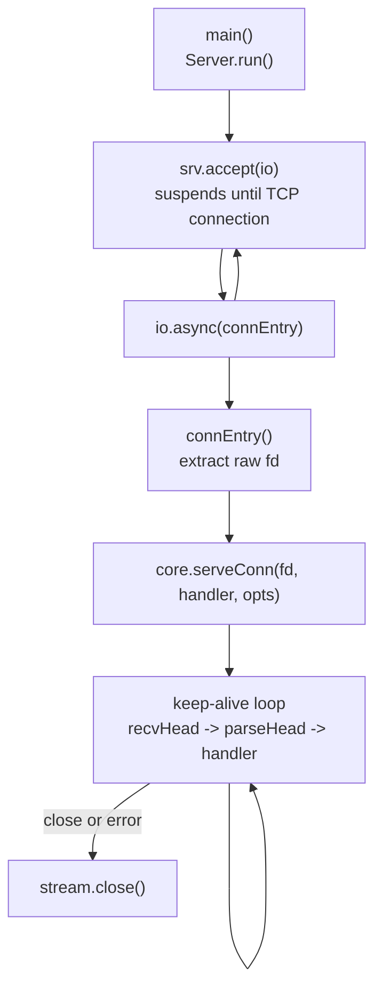
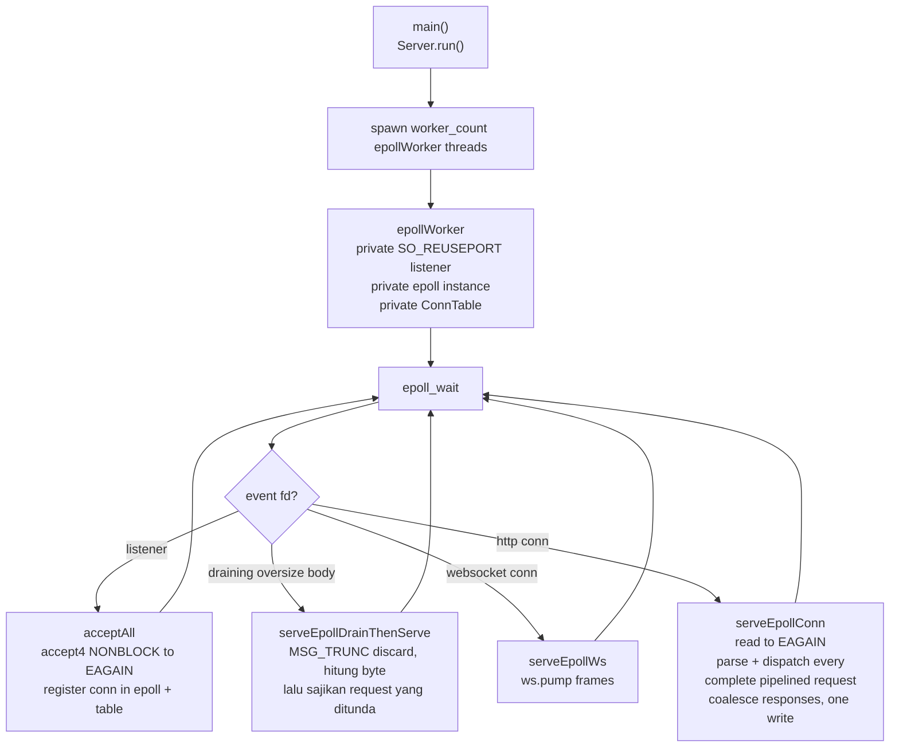
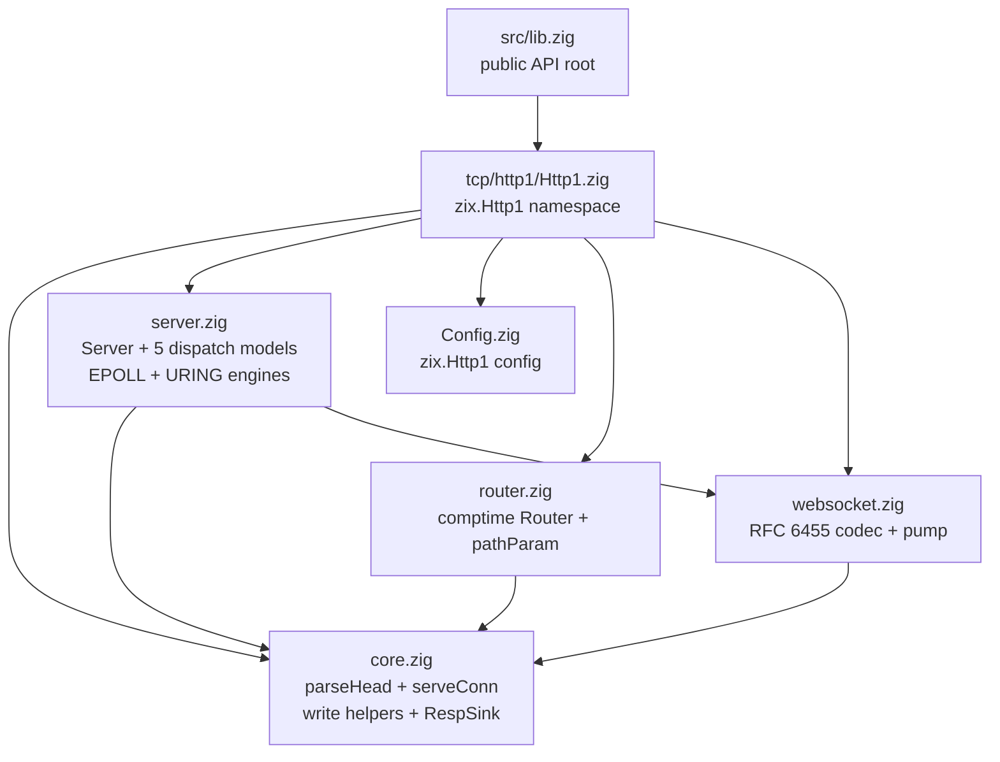
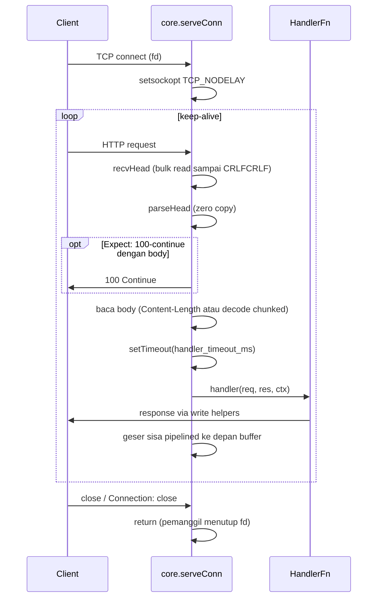
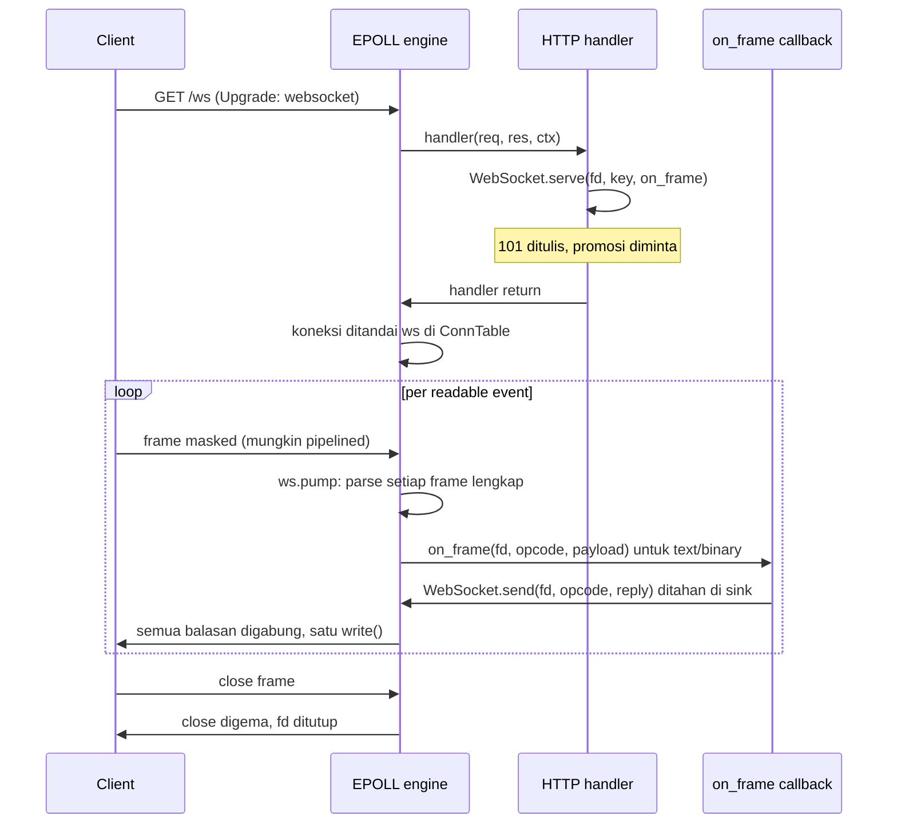

# HLD: zix.Http1

Engine server HTTP/1.x ramping di atas raw fd I/O. Parsing request dan penulisan response tanpa alokasi pada buffer milik pemanggil, tanpa dependensi `std.http`.

---

## Tujuan

- Nol alokasi heap pada hot path: parse dan write beroperasi pada buffer stack atau buffer yang dialokasikan di muka.
- Trio handler (`Request`, `Response`, `Context`) dibangun per request dari view murah di stack atas buffer itu: `Response` mendelegasikan ke write helper fd langsung, jadi ergonomi tidak mengubah wire (ADR-062).
- Comptime untuk semuanya: handler dibakukan ke dalam tipe server, tabel route dipartisi saat kompilasi.
- Raw `std.posix` I/O pada jalur data: `std.Io` hanya dipakai untuk plumbing listen/accept.
- Permukaan API minimal: satu signature handler, sekumpulan kecil write helper, dan router comptime yang opsional.

---

## Model Runtime

Tiga model dispatch, dipilih melalui `config.dispatch_model` (enum `DispatchModel`). Wajib: pemanggil harus menyetelnya secara eksplisit (tidak ada default). `.EPOLL` dan `.URING` khusus Linux, dan `run()` menolak keduanya di luar Linux dengan `error.ZixDispatchModelUnsupported` alih-alih diam-diam menyajikan model lain (ADR-065).

### .ASYNC: Accept Tunggal, Dispatch io.async()



- Satu accept thread, setiap koneksi di-dispatch sebagai task konkuren melalui `io.async()`.
- `workers` diabaikan (selalu tepat satu accept thread).
- Satu-satunya model yang tersedia di semua platform, jadi ini model yang dipakai setiap target non-Linux.

### .EPOLL: Event Loop Shared-Nothing (khusus Linux)



- Setiap worker memiliki listener pribadi, instance epoll pribadi, dan connection table pribadi. Kernel menyeimbangkan koneksi baru di antara listener per-worker (`SO_REUSEPORT`), sehingga tidak ada accept thread, tidak ada queue bersama, dan tidak ada perpindahan fd antar thread.
- Request pipelined yang tiba dalam satu readable event semuanya di-parse dan di-dispatch dalam satu pass, dan response-nya digabung menjadi satu `write()` melalui response sink per-event.
- Di luar Linux, `run()` mengembalikan `error.ZixDispatchModelUnsupported` setelah mencatat model mana yang ditolak: pakai `.ASYNC` di sana.
- Ini satu-satunya model yang menghormati promosi WebSocket milik engine (lihat bagian WebSocket).

### .URING: Event Loop io_uring Shared-Nothing (khusus Linux)

`zix.Http1` adalah engine referensi untuk jalur io_uring (ADR-037). Topologi shared-nothing, thread-per-core yang sama dengan `.EPOLL` (listener `SO_REUSEPORT` pribadi dan satu ring per worker), tetapi completion-based: accept, recv, send, dan close disubmit sebagai SQE dan dipanen sebagai CQE, sehingga sebagian besar transisi syscall di-batch ke dalam ring. Pump WebSocket juga berjalan native di ring (BufferGroup). Di luar Linux, `run()` mengembalikan `error.ZixDispatchModelUnsupported`, dan saat io_uring sendiri tidak tersedia di host Linux engine melipat ke loop `.EPOLL` dengan notice yang dicatat. Di loopback setara `.EPOLL` pada throughput dan menang terutama pada cache locality per-request.

Teardown juga me-ring close-nya (`prep_close`, ADR-041) alih-alih `linux.close` sinkron, jadi worker terus memanen completion lintas teardown koneksi. Di mesin 64-core inilah pembedanya di bawah connection churn: dengan close sinkron ring nyaris tidak mengaktifkan core-nya di bawah reconnect storm, dengan ring close ia mengisinya dan mencapai paritas atau lebih baik di setiap cell dengan memori jauh lebih sedikit. `OpKind` io_uring bersama dan helper ring berada di `src/multiplexers/ring.zig`. Lihat ADR-041 untuk pengukurannya.

---

## Struktur Berkas



---

## API Publik

Diakses melalui `const zix = @import("zix");`

| Simbol | Tipe | Deskripsi |
| :- | :- | :- |
| `zix.Http1.Server` | struct | `init(comptime handler, config)` mengembalikan server, lalu `run()` / `deinit()` (pintu tunggal, ADR-062) |
| `zix.Http1.ServerConfig` | struct | Konfigurasi server (lihat bagian zix.Http1 config) |
| `zix.Http1.DispatchModel` | enum(u8) | `.ASYNC`(0, portabel) `.EPOLL`(1, hanya Linux) `.URING`(2, hanya Linux) |
| `zix.Http1.HandlerFn` | type | `*const fn(req: *Request, res: *Response, ctx: *Context) anyerror!void` (trio, ADR-062) |
| `zix.Http1.Request` | struct | View request zero-copy: `method()`, `path()`, `query()`, `queryParam`, `header`, `pathParam`, `body()`, `bodyReceived()`, `bodyComplete()`, `keepAlive`, `pathSegments`, `queryParams`, `fromRaw` |
| `zix.Http1.Response` | struct | Builder response di atas writer fd: `setStatus`, `setContentType`, `setKeepAlive`, `addHeader`, `send`, `sendJson`, `sendText`, `sendRaw`, `sendNoContent`, `sendFromCache`, `sendCached`, `sendNegotiated`, `sendStream`, plus flag `sent` |
| `zix.Http1.Context` | struct | io, arena allocator per-request, escape hatch fd, `withDeadline` |
| `zix.Http1.Method` / `Status` / `Content` / `ContentType` | namespace | Permukaan trio bertipe (`setStatus(Status.Code)`, `setContentType(Content.Type)`, `req.method()` mengembalikan `Method.Code`), identik di kedua engine. `Method.Code` memuat `QUERY` (RFC 10008). `Content.typeFromString` / `typeFromHeader` mengembalikan `?Type`, null berarti nilai itu tidak menyebut type yang dikenal tabel. Tiap namespace punya satu lookup per arah: `stringFromEnum(value)` untuk string-nya (`value.asString()` adalah fungsi yang sama, ditulis sebagai pemanggilan method), dan `codeFromString` / `typeFromString` untuk nilainya |
| `zix.Http1.Header` / `HeaderSize` | struct / enum | Entri `addHeader` dan kelas kapasitasnya (`max_response_headers`) |
| `zix.Http1.Multipart` / `MultipartField` | struct | Parser multipart bersama |
| `zix.Http1.SseWriter` | struct | Writer event SSE yang dikembalikan `res.sendStream()` |
| `zix.Http1.ParsedHead` | struct | Head request hasil parse zero-copy (method, path, query, raw_headers, flags, span accept_encoding) |
| `zix.Http1.Range` | struct | `{ start: u64, end: u64 }` dari `parseRange` |
| `zix.Http1.ServeOpts` | struct | Opsi `serveConn`: `nodelay`, `handler_timeout_ms` |
| `zix.Http1.ConnOutcome` | enum | `.keep_alive` atau `.close` (hasil one-shot EPOLL) |
| `zix.Http1.Route` | struct | `{ path, handler, kind = .EXACT }` |
| `zix.Http1.RouteKind` | enum(u8) | `.EXACT` `.PREFIX` `.PARAM` |
| `zix.Http1.Router` | fn | `Router(comptime routes) type`, mengekspos `dispatch` yang dapat dipakai sebagai HandlerFn |
| `zix.Http1.PathParam` | struct | Satu `:param` yang tertangkap (name, value) |
| `zix.Http1.pathParam` | fn | Mencari param yang tertangkap dari dalam handler |
| `zix.Http1.WebSocket` | namespace | Codec RFC 6455: `parseFrame` / `buildFrame` / `acceptKey` / `upgrade` / `send` / `serve` / `pump` |
| `zix.Http1.WsFrameFn` | type | Callback per-frame untuk WebSocket milik engine |
| `zix.Http1.setTimeout` | fn | Memasang atau memperpendek deadline per-handler (thread-local) |
| `zix.Http1.isExpired` | fn | Apakah deadline handler saat ini sudah lewat |
| `zix.Http1.parseHead` | fn | Parse head request lengkap dari buffer (zero copy). `error.ZixUnknownMethod` untuk method yang tidak diimplementasikan engine ini, `error.ZixInvalidRequest` untuk request line yang rusak |
| `zix.Http1.parseErrorResponse` | fn | Bytes response untuk parse yang gagal: 501 untuk `error.ZixUnknownMethod`, 400 untuk sisanya |
| `zix.Http1.getHeader` | fn | Pencarian header case-insensitive pada ParsedHead |
| `zix.Http1.acceptEncoding` | fn | Nilai Accept-Encoding sebuah ParsedHead: O(1) dari span parse-pass, fallback getHeader selain itu |
| `zix.Http1.setCache` | fn | Memasang atau melepas response cache per-worker |
| `zix.Http1.setExternalHandler` | fn | Mendaftarkan callback per-worker untuk readability fd eksternal (socket driver `.URING`) |
| `zix.Http1.uringWatchFd` | fn | Memasang watch readable multishot untuk fd asing di ring milik worker |
| `zix.Http1.queryParam` | fn | Pemindaian linear satu query parameter berdasarkan nama persis |
| `zix.Http1.percentDecode` | fn | Percent-decode buffer secara in place |
| `zix.Http1.parseRange` | fn | Parse `bytes=start-end` menjadi `Range` |
| `zix.Http1.writeAllFD` | fn | Menulis semua byte ke fd (sadar sink, menangani EINTR/EAGAIN) |
| `zix.Http1.responseReserve` | fn | Reserve region render di tempat pada response sink (byte body ditulis sekali) |
| `zix.Http1.responseCommit` | fn | Menyegel render hasil reserve, engine membangun header sederhana di depan body |
| `zix.Http1.flushPending` | fn | Flush byte response yang masih tertahan sebelum raw fd write (urutan pipelining) |
| `zix.Http1.beginStream` | fn | Memulai response streaming (SSE), melepas sink jadi write flush per event (cleartext + TLS) |
| `zix.Http1.sendSimpleFD` | fn | Response lengkap dengan body Content-Length |
| `zix.Http1.sendSimpleNoBodyFD` | fn | Response headers saja (method HEAD) |
| `zix.Http1.sendJsonFD` | fn | Singkatan `sendSimpleFD` dengan `application/json` |
| `zix.Http1.sendChunkedStartFD` | fn | Memulai response `Transfer-Encoding: chunked` |
| `zix.Http1.sendChunkFD` | fn | Menulis satu chunk |
| `zix.Http1.sendChunkedEndFD` | fn | Mengakhiri body chunked |
| `zix.Http1.sendRangeFD` | fn | 206 Partial Content atau 416 berdasarkan nilai header Range |
| `zix.Http1.send100ContinueFD` | fn | Mengirim `100 Continue` manual di jalur raw (engine sudah menjawab `Expect: 100-continue` pada semua dispatch model) |

---

## zix.Http1 config

```zig
// src/zix/tcp/http1/Config.zig, field di file scope
io:                               std.Io,                  // plumbing listen dan accept
ip:                               []const u8,
port:                             u16,                     // harus non-zero
logger:                           ?*Logger = null,         // baris lifecycle, lihat bagian Logging
dispatch_model:                   DispatchModel,
workers:                          usize = 0,               // 0 = cpu_count, diabaikan .ASYNC
worker_stack_size_bytes:          usize = 1 * 1024 * 1024,
compress_worker_stack_size_bytes: usize = 2 * 1024 * 1024, // stack worker saat compress aktif
kernel_backlog:                   u31 = 1 * 1024,          // backlog listen() TCP
handler_timeout_ms:               u32 = 0,                 // budget per-handler, 0 = nonaktif
max_recv_buf:                     usize = 4 * 1024,        // buffer per-connection, 0 = ServeOpts.BUF_SIZE
max_request_body:                 usize = 2 * 1024 * 1024, // batas Content-Length yang dideklarasikan, melewatinya 413, 0 = tanpa cek
large_body_recv_buf:              usize = 0,               // SO_RCVBUF khusus jalur body besar, 0 = default kernel
send_date_header:                 bool = true,             // false membuang header Date
max_response_headers:             HeaderSize = .MINIMAL,   // kelas kapasitas addHeader
compress:                         bool = false,            // negosiasi Accept-Encoding
compression_min_size:             usize = 256,             // lewati body di bawah ukuran ini
compression_max_out:              usize = 256 * 1024,      // output terkompresi yang lebih besar dikirim tanpa kompresi
response_cache:                   bool = false,            // response cache per-worker
cache_ttl_ms:                     u32 = 1000,              // freshness cache default
cache_max_entries:                u32 = 256,               // dibulatkan ke bawah ke pangkat dua
cache_max_value_bytes:            u32 = 16 * 1024,         // response yang lebih besar melewati cache
public_dir:                       []const u8 = "",         // root static file, kosong = mati
public_dir_upload:                []const u8 = "u",        // subdirectory upload di bawah public_dir
public_dir_cache_ttl_ms:          u32 = 0,                 // freshness cache static file, 0 = tidak pernah cache
public_dir_cache_max_entries:     u32 = 256,               // jumlah slot cache static file
```

Referensi field lengkap (arti, trade-off, kapan diubah) ada di [`docs/zix-config-id.md`](zix-config-id.md).

Catatan: pada `.ASYNC` loop koneksi meminjam pasangan buffer receive + body milik pool thread (`core.threadConnBufs`), masing-masing `max_recv_buf` byte, dipakai ulang oleh setiap koneksi yang dilayani thread itu. `max_recv_buf` karenanya menentukan ukuran buffer per-connection pada semua dispatch model (pemanggil `core.serveConn` langsung yang membiarkan `ServeOpts.max_recv_buf` di 0 mendapat `core.BUF_SIZE` = 16 KB). `large_body_recv_buf` menyetel `SO_RCVBUF` hanya pada jalur body besar (upload), membiarkan cell request kecil pada default kernel. `tls` opt-in ke native https: saat non-null server menyajikan HTTP/1.1 di atas TLS pada jalur ter-gate, selain itu cleartext. Field `compress`, `compression_min_size`, dan `compression_max_out` (yang terakhir di-rename dari `max_gzip_out`) dibaca saat runtime pada semua dispatch model: handler opt-in dengan `res.sendNegotiated`. Handler yang butuh satu coding secara eksplisit memanggil `zix.utils.compression.encode` dan menyetel `Content-Encoding` sendiri. Content-Length yang dideklarasikan melewati `max_request_body` ditolak dengan `413` sebelum body dibaca (0 mematikan cek), dan body chunked dibatasi receive buffer karena tidak mendeklarasikan panjang di muka.

Catatan: `ws_recv_buf` (default 16 KiB) menentukan ukuran buffer koneksi WebSocket dan menjadi frame terbesar yang diterima. Nilai ini terpisah dari `max_recv_buf`: koneksi mengganti buffer-nya ke `ws_recv_buf` saat upgrade, di setiap dispatch model, dan scratch unmask punya ukuran yang sama (per worker di `.EPOLL` dan `.URING`, per pool thread di `.ASYNC`). `0` jatuh ke 16 KiB. Menaikkan `max_recv_buf` untuk upload tidak membesarkan koneksi WebSocket.

Catatan: `send_date_header` default `true` untuk kepatuhan RFC 7231. Set `false` pada jalur panas di mana klien tidak mengonsumsi `Date` untuk membuang header (37 byte per response). Write helper terkelola menghormati flag ini.

### Timeout

`zix.Http1` mengekspos satu timeout, `handler_timeout_ms`, budget eksekusi per-handler. Saat non-zero, server memasang deadline thread-local sebelum setiap dispatch. Handler ikut serta dengan memanggil `zix.Http1.isExpired()` di antara langkah mahal dan merespons lebih awal, atau memperpendek budget-nya sendiri dengan `zix.Http1.setTimeout()`.

`conn_timeout_ms` (ADR-062) adalah guard masa hidup koneksi: `ConnRegistry` plus background timer thread menutup koneksi yang melebihi masa hidup terkonfigurasi. Aktif pada model blocking (`.ASYNC`), tempat koneksi lambat atau idle menahan task. Pada `.EPOLL` dan `.URING` ia no-op terdokumentasi: event loop-nya memiliki umur koneksi, dan koneksi keep-alive idle tidak menahan thread, hanya satu slot dan buffernya.

| Timeout | `zix.Http1` | Mekanisme |
| :- | :- | :- |
| `handler_timeout_ms` | ya | deadline thread-local dipasang per dispatch, opt-in handler |
| `conn_timeout_ms` | ya (`.ASYNC`) | `ConnRegistry` + background timer thread |

Jika penegakan masa hidup koneksi pada `.EPOLL` / `.URING` suatu saat dibutuhkan, yang paling cocok adalah sweep idle-deadline atas tabel per-worker (tanpa thread tambahan), bukan `ConnRegistry` timer-thread.

---

## Model Handler

```zig
fn home(req: *zix.Http1.Request, res: *zix.Http1.Response, ctx: *zix.Http1.Context) anyerror!void {
    _ = ctx;

    if (req.queryParam("name")) |name| {
        _ = name; // slice ke receive buffer, hanya valid selama pemanggilan ini
    }

    res.setContentType(.TEXT_PLAIN);

    try res.send("hello");
}

var server = zix.Http1.Server.init(home, .{
    .io = process.io,
    .ip = "0.0.0.0",
    .port = 8080,
    .dispatch_model = .EPOLL,
});
try server.run();
```

- Handler adalah argumen comptime: dibakukan ke dalam tipe server, tidak ada registrasi dinamis setelah init.
- Trio dibangun per request oleh `core.invokeHandler`: `Request` adalah view zero-copy (semua slice menunjuk ke receive buffer, hanya valid selama pemanggilan), `Response` mendelegasikan ke write helper fd secara byte-identik, `Context` membawa io, arena per-request, dan escape hatch fd.
- Handler yang error dilengkapi engine dengan satu 500, hanya bila belum ada yang dijawab. Dua gaya jawaban sama-sama dihitung: builder `Response` (`Response.sent`) dan fd writer (`respondedFD`), jadi handler yang menjawab lewat `sendSimpleFD` tidak dijawab untuk kedua kalinya. Idiom rumahnya `try res.foo(...)`, tidak pernah `return res.foo(...)`. Error yang ditelan sendiri oleh handler adalah urusan handler itu, engine tidak menambahkan apa pun.
- Handler boleh berupa fungsi polos, `Router(routes).dispatch`, atau rantai wrapper comptime (idiom middleware, lihat `examples/http1_middleware.zig`).

### ParsedHead

| Field | Tipe | Catatan |
| :- | :- | :- |
| `method` | `[]const u8` | Verb apa adanya (`"GET"`, `"POST"`, ...) |
| `path` | `[]const u8` | Target tanpa query string |
| `query` | `[]const u8` | Query string mentah setelah `?`, `""` jika tidak ada |
| `raw_headers` | `[]const u8` | Blok header mentah, dipindai sesuai kebutuhan via `getHeader` (tanpa batas jumlah) |
| `version_minor` | `u8` | 1 untuk HTTP/1.1, 0 untuk HTTP/1.0 |
| `keep_alive` | `bool` | Default berdasarkan versi, ditimpa header `Connection` |
| `content_length` | `u64` | 0 saat tidak ada atau tidak bisa di-parse |
| `chunked_request` | `bool` | Ada `Transfer-Encoding: chunked` |
| `expect_continue` | `bool` | Ada `Expect: 100-continue` |
| `accept_encoding` | `HeaderSpan` | Span nilai Accept-Encoding yang ditangkap parse pass, dibaca via `acceptEncoding()` |

---

## Method QUERY (RFC 10008)

QUERY bersifat safe dan idempotent seperti `GET`, dan membawa content seperti `POST`. Ia ada untuk pertanyaan yang terlalu besar atau terlalu terstruktur untuk muat di query string URL, dan karena ia tidak mengubah apa pun, client bebas mengulanginya.

Engine melakukan parse dan klasifikasi. Keputusan content type mana yang diterima sebuah route tetap milik handler: engine tidak bisa tahu schema sebuah route tanpa config baru, dan method yang jarang dipakai tidak boleh menambah cabang di hot path.

| Kebutuhan (RFC 10008) | Dipenuhi di mana |
| :- | :- |
| Section 2: tolak request yang content type-nya hilang atau tidak konsisten | Handler, dari `req.header("content-type")` dan `Content.typeFromHeader` |
| Section 2.1: jangan pernah menebak dari content | `Content.typeFromHeader` melaporkan tidak ada kecocokan untuk type yang tidak ada di tabel, ia tidak pernah memeriksa body |
| Section 2.7: cache key harus memasukkan content request | Key-nya `hash(method, path, query)` dan tidak membawa content, jadi response QUERY tidak pernah disimpan. Meng-cache response QUERY berstatus MAY, jadi menolak tetap conformant |
| Section 3: `Accept-Query` | Ditulis handler sebagai nilai header biasa. Server hanya pernah mengirimkannya, jadi parser RFC 9651 tidak diperlukan |

Token method dicocokkan persis, sesuai RFC 9110 section 9.1. Kedua engine HTTP/1 membaca tabel yang sama (`Method.codeFromString`), jadi `query` huruf kecil bukan method QUERY di keduanya: ia menamai method yang tidak diimplementasikan kedua engine, dan jawabannya 501.

Status yang dipilih handler, sesuai section 2.1:

| Kasus | Status |
| :- | :- |
| Tidak ada `Content-Type` sama sekali | 400 |
| `Content-Type` yang tidak diterima route ini | 415, dengan `Accept-Query` menyebut apa yang diterima |
| Content diterima route tapi tidak bisa dijawab | 422 |
| `Accept` yang tidak bisa dipenuhi route | 406 |

Content type yang ada di tabel untuk query content: `application/sql`, `application/jsonpath`, `application/graphql`, `application/x-www-form-urlencoded`, `multipart/form-data`.

`examples/http1_query.zig` (port 9079) membawa pola sisi handler-nya: peta status di atas, header `Accept-Query`, dan sebuah route yang menerima dua type dan menjawab satu. `tests/runner/checks_query.zig` menjalankannya di wire.

---

## Siklus Hidup Koneksi (.ASYNC)



Response error yang ditulis engine sendiri: `431` saat blok header melebihi receive buffer, `501` saat method-nya tidak diimplementasikan engine ini, `400` saat request line rusak atau body chunked tidak bisa di-framing, `413` saat body yang dideklarasikan melewati `max_request_body` (atau body chunked melampaui buffer). Semuanya menutup koneksi. Router (bila dipakai) menulis `404` untuk path yang tidak cocok.

---

## Router

### Registrasi: tabel route comptime

```zig
const Routes = zix.Http1.Router(&[_]zix.Http1.Route{
    .{ .path = "/",          .handler = home },
    .{ .path = "/api",       .handler = api,  .kind = .PREFIX },
    .{ .path = "/users/:id", .handler = user, .kind = .PARAM },
});

var server = zix.Http1.Server.init(Routes.dispatch, .{ .io = process.io, .ip = "0.0.0.0", .port = 8080 });
```

| `kind` | Contoh pattern | Perilaku |
| :- | :- | :- |
| `.EXACT` (default) | `"/about"` | Cocok hanya jika path penuh sama dengan `path` |
| `.PREFIX` | `"/api"` | Cocok dengan `path` dan sub-path apa pun pada batas `/` |
| `.PARAM` | `"/users/:id"` | Segmen `:name` ditangkap, literal harus cocok persis |

### Dispatch: aturan prioritas

```
Pass 1: exact routes   StaticStringMap comptime O(1)     (urutan registrasi tidak berpengaruh)
Pass 2: param routes   pattern pertama yang cocok menang  (urutan registrasi berpengaruh)
Pass 3: prefix routes  prefix terpanjang yang cocok menang (urutan registrasi tidak berpengaruh)

exact > param > prefix (prefix lebih panjang mengalahkan yang lebih pendek)
```

Route dipartisi berdasarkan kind saat kompilasi: path exact masuk `StaticStringMap`, route param dan prefix masuk array comptime yang ditelusuri dengan `inline for`. Path yang tidak cocok mendapat `404 text/plain` dari `dispatch` sendiri.

### Path params

`pathParam("id")` di dalam handler mengembalikan segmen yang tertangkap. Hasil tangkapan hidup di penyimpanan thread-local yang ukurannya ditentukan saat compile time dari route dengan `:param` terbanyak pada router itu (tanpa batas tetap) dan hanya valid selama pemanggilan dispatch, sama dengan masa hidup slice request.

---

## Budget Handler: setTimeout / isExpired

Saat `config.handler_timeout_ms > 0` engine memasang deadline thread-local sebelum setiap dispatch. Handler ikut serta dengan memanggil `zix.Http1.isExpired()` di antara langkah-langkah yang mahal:

```zig
fn slow(req: *zix.Http1.Request, res: *zix.Http1.Response, ctx: *zix.Http1.Context) anyerror!void {
    _ = req;
    _ = ctx;

    doStep1();
    if (zix.Http1.isExpired()) {
        res.setStatus(.REQUEST_TIMEOUT);
        try res.sendJson("{\"error\":\"timeout\"}");
        return;
    }

    doStep2();

    try res.sendJson("{\"result\":\"ok\"}");
}
```

- `isExpired()` selalu aman dipanggil: mengembalikan `false` saat tidak ada deadline terpasang. Pengecekannya satu `clock_gettime` plus satu perbandingan.
- `setTimeout(ms)` memasang ulang deadline untuk handler saat ini (memperpendek atau memperpanjang), `setTimeout(0)` menghapusnya, dan `ctx.withDeadline` adalah pembungkus sisi trio.
- Deadline bersifat thread-local, mengikuti model eksekusi satu-request-per-worker.

---

## WebSocket: Koneksi Milik Engine

`zix.Http1.WebSocket` adalah codec RFC 6455 plus model koneksi milik engine. Handler menyelesaikan handshake dan mendaftarkan callback per-frame, lalu return. Engine menggerakkan frame loop dari event loop-nya, sehingga tidak pernah ada worker yang terparkir pada satu koneksi.



- `WebSocket.serve(fd, key, on_frame)` menghitung accept key, menulis `101 Switching Protocols`, dan meminta promosi melalui slot handoff thread-local yang dibaca engine tepat setelah handler return.
- Ping otomatis dibalas pong dan close otomatis digema oleh engine. Callback hanya pernah menerima frame text dan binary.
- Frame yang dikirim dalam satu pass pump digabung menjadi satu `write()`.
- Promosi dihormati pada `.ASYNC` (blocking loop), `.EPOLL` (pump event loop), dan `.URING` (pump staged, satu ring send per pass).
- Frame yang lebih besar dari `ws_recv_buf` dijawab close `1009` dan koneksi berakhir.
- `WebSocket.serveTls` (wss) belum di-porting ke `zix.Http1`. TLS adalah langkah terpisah.

Lihat `examples/http1_websocket.zig` (cleartext). Contoh wss menunggu langkah TLS.

---

## Logging

`config.logger` hanya menerima baris lifecycle server (notice listening, fallback EPOLL). Saat null, baris lifecycle dicetak ke stderr hanya pada Debug build dan diam pada release build (server release tanpa logger tidak mengeluarkan output lifecycle).

Access logging per-request adalah tanggung jawab engine, bukan handler. Saat `config.logger` diisi, engine menulis satu record `[http1:access]` setelah setiap request yang dilayani, mengambil status dan jumlah byte dari `Response`. Handler yang menulis langsung ke fd alih-alih lewat `Response` tetap tercatat, tetapi jumlah byte-nya terbaca 0, sehingga handler seperti itu boleh memanggil `logger.access()` sendiri di titik ukuran sebenarnya diketahui.

---

## Model Memori

| Lingkup | Penyimpanan | Masa hidup |
| :- | :- | :- |
| Tabel route | comptime (nol biaya heap) | Proses |
| Buffer receive + body (.ASYNC) | pasangan pool-thread (`threadConnBufs`), masing-masing `max_recv_buf` byte, hanya tumbuh, dipakai ulang lintas koneksi thread itu | Pool thread |
| Buffer per-connection (.EPOLL) | slab per-worker, slot kompak page-aligned, `max_recv_buf` byte terpakai | Koneksi |
| Buffer recv + send per-connection (.URING) | slab stride mmap per-worker, slot kompak, THP di-opt-out | Koneksi |
| Staging body + output (.EPOLL) | `smp_allocator`, per worker | Worker thread |
| Output kompresi (`sendNegotiated`) | body ter-encode di allocator per-request, dibebaskan setelah `send` | Request |
| Scratch kompresi | state std flate dan tabel brotli di heap per pemanggilan, tabel hash gzip cepat adalah satu threadlocal 16 KiB | Pemanggilan / worker thread |
| Arena per-request (`ctx.allocator`) | per worker (event loop) atau per koneksi (model blocking), di-reset per dispatch | Request |
| Alokasi handler | `ctx.allocator` (arena), atau bawa sendiri | Request |

---

## Batasan yang Diketahui

| Batas | Perilaku |
| :- | :- |
| Ukuran blok header | Maksimum `max_recv_buf` byte pada semua dispatch model (default 6 KB, pemanggil `serveConn` langsung mendapat `core.BUF_SIZE` = 16 KB). Melebihi mengembalikan `431` dan menutup |
| Body pada .ASYNC | Handler melihat paling banyak `max_recv_buf` byte body. Body Content-Length yang lebih besar sisanya dibuang dari socket agar koneksi keep-alive tetap dapat dipakai: `req.bodyReceived()` melaporkan total terhitung, `req.bodyComplete()` apakah peer mengirim seluruhnya |
| Body pada .EPOLL / .URING | Harus muat di `max_recv_buf` dikurangi head. Body yang lebih besar menjaga koneksi tetap dapat dipakai dengan membuang sisanya dari socket (`MSG_TRUNC`): kedua model menunda handler sampai drain selesai, lalu menjalankannya dengan total terhitung di `req.bodyReceived()` dan slice body kosong |
| Body yang dideklarasikan melewati `max_request_body` | Ditolak dengan `413` sebelum satu byte body pun dibaca atau di-drain, pada semua dispatch model (default 2 MiB, 0 mematikan cek) |
| Body request besar (upload) | Drain melebarkan receive window via `large_body_recv_buf` (SO_RCVBUF), lihat [`docs/zix-config-id.md`](zix-config-id.md) |
| Body request chunked | Di-decode ke body buffer. Frame yang tidak bisa dijalani decoder dijawab `400`, body chunked melewati buffer dijawab `413` (chunked tidak mendeklarasikan panjang di muka, jadi buffer menggantikan `max_request_body`) |
| Versi HTTP | Hanya HTTP/1.0 dan HTTP/1.1, selain itu `400` |
| TLS | https/1.1 native (TLS 1.3 + 1.2), opt-in via `config.tls`, pada perf band-nya sendiri. `.ASYNC` melakukan terminasi per koneksi di worker thread, `.EPOLL` / `.URING` di worker epoll-mux event-driven. Lihat [`docs/hld-tls-id.md`](hld-tls-id.md) |

Endpoint yang menerima upload besar membaca `req.bodyReceived()` pada semua dispatch model (byte yang dibuang dihitung, tidak di-buffer) dan `req.bodyComplete()` untuk membedakan upload yang selesai dari yang diputus peer.

Untuk detail implementasi lihat [`docs/lld-http1-id.md`](lld-http1-id.md).

---

###### end of hld-http1
