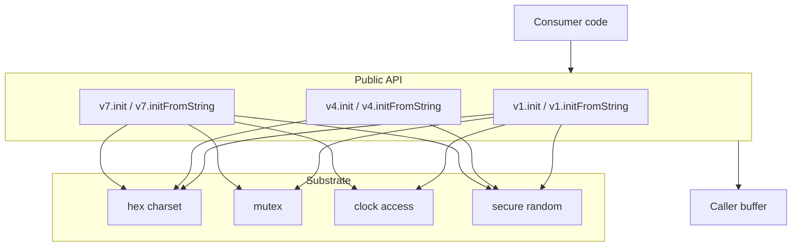
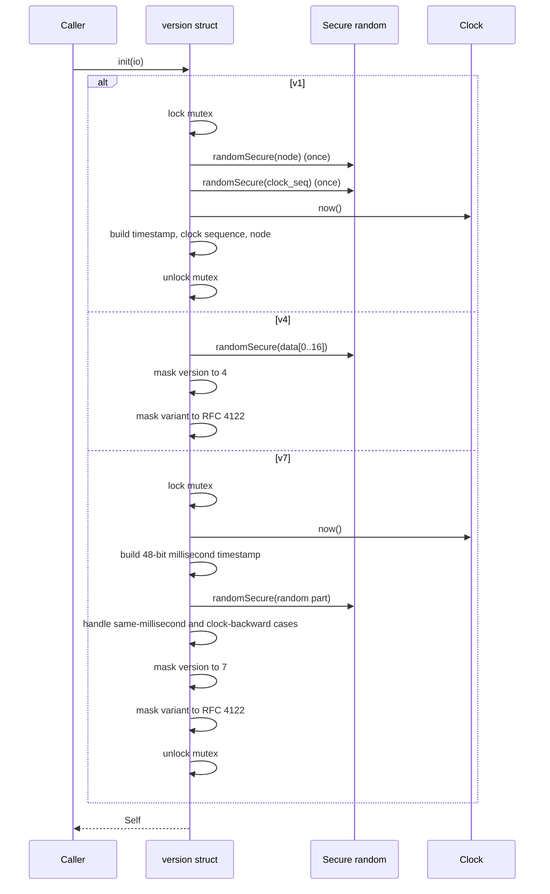
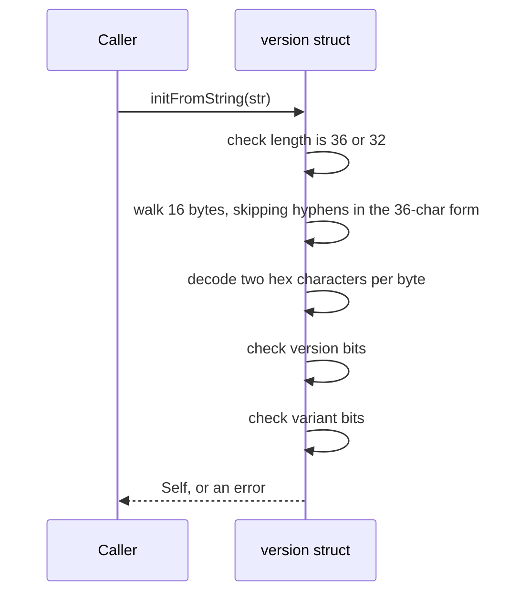
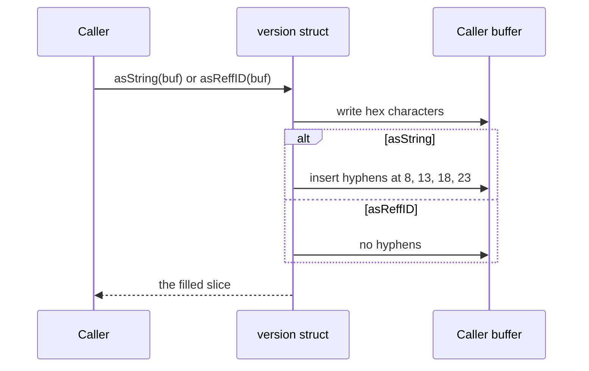

# uuidz high-level design

## Scope

`uuidz` is a UUID library in pure Zig, standard library only. It generates and parses the three UUID versions that cover the common cases: v1 for legacy time-based identifiers, v4 for random identifiers, and v7 for time-ordered identifiers.

This document covers the shape of the library: the layers, the components, the three flows, and the shared substrate. The bit-level detail is in `lld-en.md`.

The design holds to one idea: every version exposes the same four calls, so a caller that swaps one version for another changes what the identifier carries and nothing else about how it is used.

 

## Layers

- The API layer is three structs, one per version. Each owns the same four calls and the version-specific bit layout.
- The substrate owns the mechanics: the hex alphabet, the mutex that makes v1 and v7 safe under concurrency, the clock read, and the secure random fill.
- The buffer belongs to the caller. `uuidz` holds neither a buffer nor an allocator.

 

## Components

| Component | Responsibility |
| :- | :- |
| `lib.zig` | The public surface: exports `v1`, `v4`, `v7`, and the shared version constants |
| `hex.zig` | The one hex alphabet: `0123456789abcdef` |
| `v1.zig` | Version 1: timestamp, clock sequence, node, mutex, and epoch offset |
| `v4.zig` | Version 4: secure random fill and version/variant masking |
| `v7.zig` | Version 7: millisecond timestamp, monotonicity handling, version/variant masking |

 

## The generate flow

Nothing allocates. A generated UUID is 16 bytes in the version struct's `data` field.

 

## The parse flow

No allocation. The parsed value owns its 16 bytes inline.

 

## The format flow

No allocation. The caller supplies the buffer: `[36]u8` for `asString`, `[32]u8` for `asReffID`.

 

## Allocation model

| Direction | What is allocated | Who owns it |
| :- | :- | :- |
| Generate | nothing | the returned struct holds the 16 bytes inline |
| Parse | nothing | the returned struct holds the 16 bytes inline |
| Format | nothing | the caller's fixed buffer holds the whole string |

 

## Error model

Two error sets, one for generation and one for parsing.

- `init` reports only errors from the IO layer (random fill or clock read). It does not allocate and does not validate the result.
- `initFromString` reports the parse set: `InvalidUuidLength`, `InvalidUuidFormat`, `InvalidHexCharacter`, `InvalidUuidVersion`, `InvalidUuidVariant`. Every version uses the same set.

Swapping a version never changes what a caller has to handle on the parse side. The generation side inherits the IO error set from the standard library.
