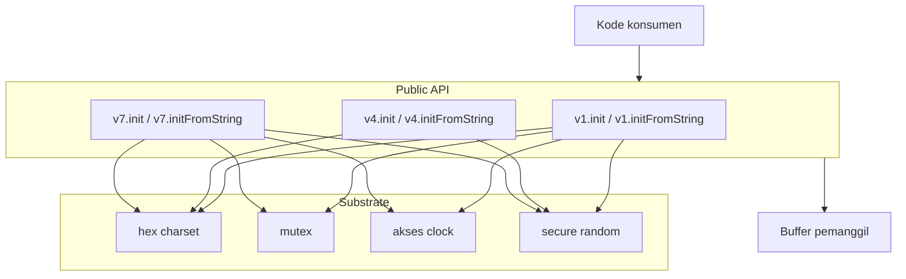
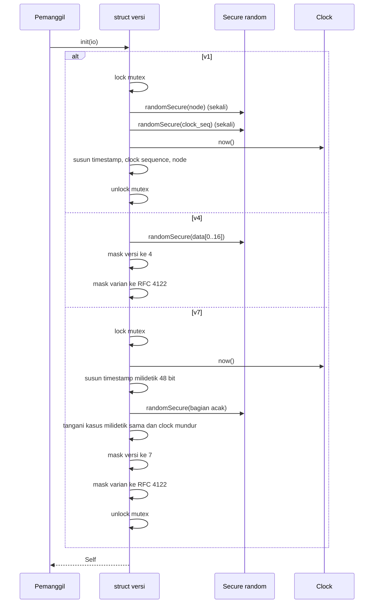
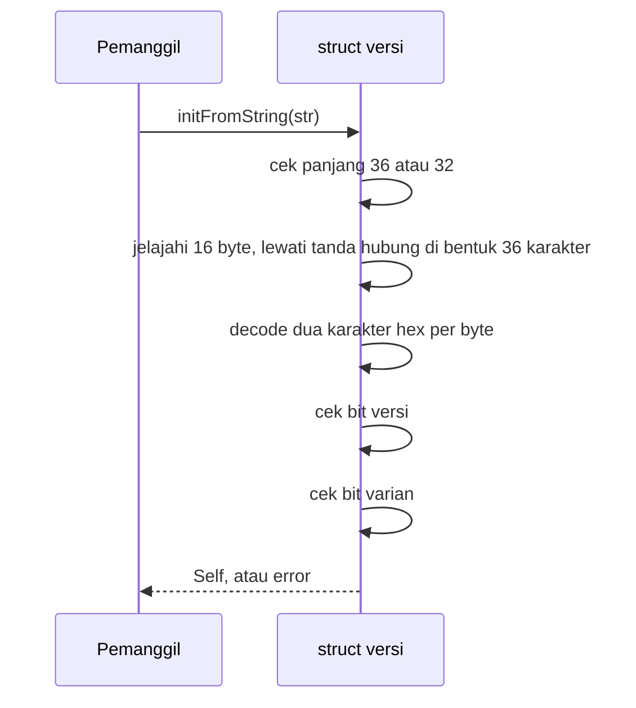
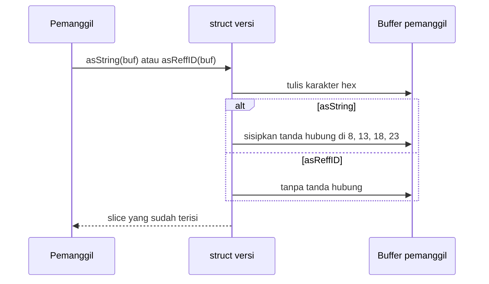

# uuidz high-level design

## Scope

`uuidz` adalah library UUID dengan Zig murni, hanya library standar. Library ini men-generate dan mem-parse tiga versi UUID yang mencakup kasus umum: v1 untuk identifier berbasis waktu lama, v4 untuk identifier acak, dan v7 untuk identifier terurut waktu.

Dokumen ini membahas bentuk library: layer, komponen, tiga alur, dan substrate bersama. Detail tingkat bit ada di `lld-en.md`.

Desain memegang satu ide: setiap versi menyediakan empat call yang sama, sehingga pemanggil yang menukar satu versi ke versi lain hanya mengubah apa yang dibawa identifier dan tidak mengubah cara pakainya.

 

## Layer

- Layer API adalah tiga struct, satu per versi. Masing-masing memiliki empat call yang sama dan layout bit khusus versinya.
- Substrate memiliki mekanismenya: hex alphabet, mutex yang membuat v1 dan v7 aman saat konkurensi, pembacaan clock, dan pengisian secure random.
- Buffer milik pemanggil. `uuidz` tidak memegang buffer maupun allocator.

 

## Komponen

| Komponen | Tanggung jawab |
| :- | :- |
| `lib.zig` | Permukaan publik: mengekspor `v1`, `v4`, `v7`, dan konstanta versi bersama |
| `hex.zig` | Satu hex alphabet: `0123456789abcdef` |
| `v1.zig` | Versi 1: timestamp, clock sequence, node, mutex, dan epoch offset |
| `v4.zig` | Versi 4: pengisian secure random dan masking versi/varian |
| `v7.zig` | Versi 7: timestamp milidetik, penanganan monotonicity, masking versi/varian |

 

## Alur generate

Tidak ada alokasi. UUID hasil generate adalah 16 byte di field `data` pada struct versi.

 

## Alur parse

Tidak ada alokasi. Nilai hasil parse memiliki 16 byte inline.

 

## Alur format

Tidak ada alokasi. Pemanggil menyediakan buffer: `[36]u8` untuk `asString`, `[32]u8` untuk `asReffID`.

 

## Model alokasi

| Arah | Apa yang dialokasikan | Siapa pemiliknya |
| :- | :- | :- |
| Generate | tidak ada | struct yang dikembalikan memegang 16 byte inline |
| Parse | tidak ada | struct yang dikembalikan memegang 16 byte inline |
| Format | tidak ada | buffer tetap milik pemanggil memegang seluruh string |

 

## Model error

Dua kumpulan error, satu untuk generate dan satu untuk parse.

- `init` hanya melaporkan error dari layer IO (pengisian random atau pembacaan clock). Ini tidak mengalokasikan dan tidak memvalidasi hasilnya.
- `initFromString` melaporkan kumpulan parse: `InvalidUuidLength`, `InvalidUuidFormat`, `InvalidHexCharacter`, `InvalidUuidVersion`, `InvalidUuidVariant`. Setiap versi memakai kumpulan yang sama.

Menukar versi tidak pernah mengubah apa yang harus ditangani pemanggil di sisi parse. Sisi generate mewarisi kumpulan error IO dari library standar.
