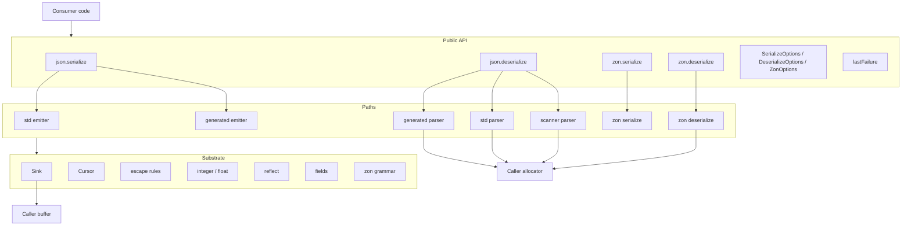
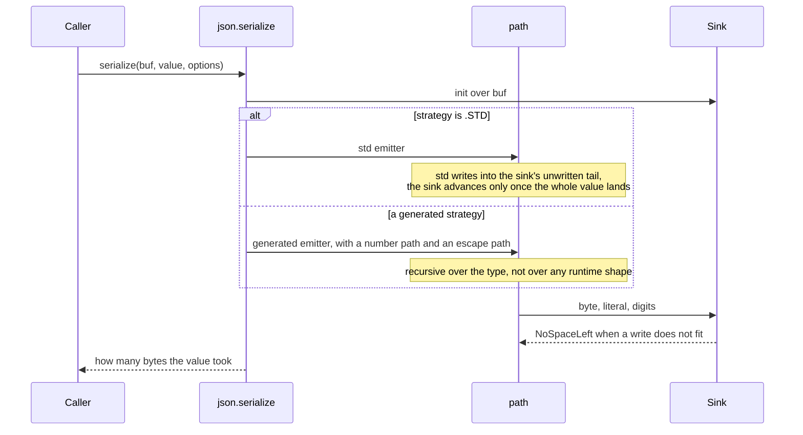
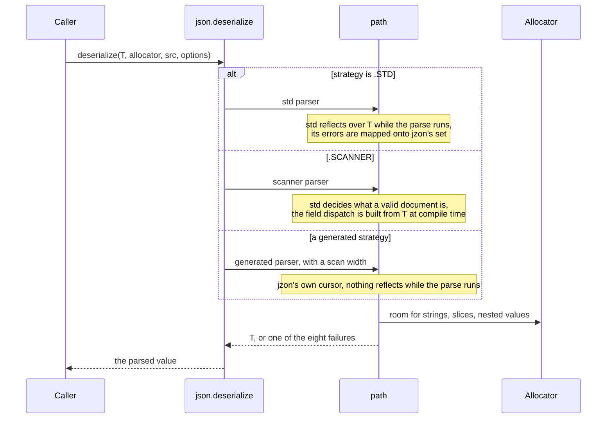
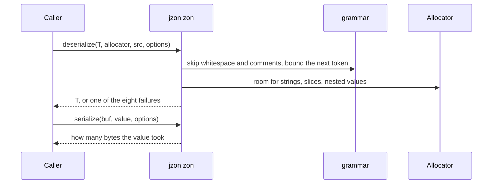

# jzon high-level design

## Scope

jzon is a JSON and ZON library in pure Zig, standard library only. It reads and writes the RFC 8259 JSON grammar and the ZON shape `build.zig.zon` uses directly. This document covers the shape of the library: the layers, the components, the flows, and how a strategy picks a path. The byte-level detail is in `lld-en.md`.

The JSON design holds to one idea: every path produces the same bytes and reads the same documents, so a caller who swaps one for another changes what the call costs and nothing else. ZON has one path per direction, so it has no strategy to pick.

## Layers

- The API layer is two namespaces, `jzon.json` and `jzon.zon`, each with one `serialize` and one `deserialize`, plus their options and error sets. For JSON it owns one decision: which path runs.
- A path owns how a value is rendered or read. It never sees which strategy named it.
- The substrate owns the mechanics: where the next byte goes, where a token ends, how a byte is escaped, how a number is spelled, which fields a document filled in, and the type questions asked at compile time.
- The buffer and the allocator belong to the caller. jzon holds neither, and it never touches a file.

## Components

| Component | Responsibility |
| :- | :- |
| `lib.zig` | the public surface: `json`, `zon`, `lastFailure`, the version |
| `Sink.zig` | the write cursor: where the next byte goes and whether there is room |
| `Cursor.zig` | the JSON read cursor: where the next byte comes from and where a token ends |
| `StringSpan.zig` | a located string token: the bytes between the quotes, and whether they hold an escape |
| `lane.zig` | the vector lane width and the escape test on one chunk |
| `cursor_vector.zig` | the same two cursor scans a lane at a time: whitespace skip, string end |
| `escape.zig` | the RFC 8259 section 7 string rules, both directions, one owner |
| `escape_vector.zig` | the same encoding, with the escape scan a lane at a time |
| `integer.zig` | two ways to write an integer, one way to read one back with range enforced |
| `float.zig` | the JSON number form of a float, both directions |
| `reflect.zig` | the type questions asked at compile time, in one place |
| `serialize/SerializeOptions.zig` | what a caller hands a JSON render |
| `serialize/EmitShape.zig` | which number and escape path a generated render takes |
| `serialize/serialize.zig` | the JSON write entry point: pick a path, run it, report the length |
| `serialize/std_emitter.zig` | render through `std.json.Stringify` into the caller's buffer |
| `serialize/generated_emitter.zig` | render through code built from the type at compile time |
| `deserialize/DeserializeOptions.zig` | what a caller hands a JSON parse |
| `deserialize/deserialize.zig` | the JSON read entry point: pick a path and run it |
| `deserialize/Failure.zig` | which field and which byte the last failed parse on this thread stopped on |
| `deserialize/std_parser.zig` | parse through `std.json` reflection, with std's errors mapped onto jzon's set |
| `deserialize/scanner_parser.zig` | tokens from `std.json.Scanner`, dispatch built from the type |
| `deserialize/generated_parser.zig` | parse straight off jzon's cursor, dispatch built from the type |
| `deserialize/fields.zig` | which of a target's fields a document filled in, and what happens to the rest |
| `deserialize/ScanShape.zig` | which of the two read scans a parse runs |
| `deserialize/skip.zig` | step over one whole JSON value without building anything out of it |
| `deserialize/string_value.zig` | a string token into bytes: a slice of the document, or a copy |
| `zon/lib.zig` | the `jzon.zon` namespace |
| `zon/ZonOptions.zig` | what a caller hands a ZON call, both directions |
| `zon/grammar.zig` | ZON byte classes and token bounds: whitespace, comments, names, numbers, strings |
| `zon/serialize.zig` | write a typed value as ZON, multiline or compact |
| `zon/deserialize.zig` | read ZON into a typed value, generated from the type |

## The JSON write flow

Nothing allocates. A value that does not fit reports `Jzon_Serialize_NoSpaceLeft` and no length, so whatever the buffer holds afterwards is not a rendered value either way.

## The JSON read flow

Everything the result points at comes from the caller's allocator. Under `strings = .BORROW` a string carrying no escape is a slice of the document instead, so the document has to outlive the value.

## The ZON flows

- The read side walks the text once, with the dispatch built from `T` at compile time. No `std.zig.Ast` is built.
- Numbers are checked with `std.zig.parseNumberLiteral` and string escapes decoded with `std.zig.string_literal`, so the Zig grammar decides what a valid number or escape is.
- The write side writes into a `Sink`, the same as JSON, in the layout `ZonOptions.layout` names. The fields `ZonOptions.hex_fields` names are written as hex.
- Field bookkeeping (missing, duplicate, defaults) is the same `fields.zig` JSON uses, and failures report through the same `lastFailure`.

## Where a strategy lands

A JSON strategy is a name for a pairing. The entry point resolves it and the path under it is handed only what it needs.

Write side:

| Strategy | Integer path | Escape scan |
| :- | :- | :- |
| `.GENERATED_FMT` | `std.fmt` | one byte at a time |
| `.GENERATED` | digits into the buffer | one byte at a time |
| `.GENERATED_VECTOR` | digits into the buffer | one vector lane at a time |

Read side:

| Strategy | Scan width |
| :- | :- |
| `.GENERATED` | one byte at a time |
| `.GENERATED_VECTOR` | one vector lane at a time |

The two write axes are independent, so every pairing exists in the emitter. The four strategies are the pairings worth naming, not the only ones the emitter can run.

## Allocation model

| Direction | What is allocated | Who owns it |
| :- | :- | :- |
| serialize, JSON and ZON | nothing | the caller's buffer holds the whole result |
| deserialize, `strings = .COPY` | every string, slice, and nested value | the caller's allocator |
| deserialize, `strings = .BORROW` | slices, nested values, and any string carrying an escape | the caller's allocator, with clean strings pointing into the document |

An escaped string is decoded into the allocator whichever mode was asked for, because its decoded bytes appear nowhere in the document to point at. A ZON multiline string of more than one line is joined into the allocator for the same reason.

## Error model

One error set per call, shared by every path under it:

| Call | Set | Failures |
| :- | :- | :- |
| `json.serialize` | `json.SerializeError` | `Jzon_Serialize_NoSpaceLeft` |
| `json.deserialize` | `json.DeserializeError` | eight: `Jzon_Deserialize_UnknownField`, `MissingField`, `UnknownEnumValue`, `Truncated`, `Unexpected`, `BadNumber`, `BadEscape`, `OutOfMemory` |
| `zon.serialize` | `zon.SerializeError` | `Jzon_ZonSerialize_NoSpaceLeft` |
| `zon.deserialize` | `zon.DeserializeError` | the same eight conditions as `Jzon_ZonDeserialize_*` |

Each module owns its own set and translates what the functions it calls report once, at its public function. A JSON path that cannot tell two failures apart still reports through the same set: `.STD` reports a broken escape as a syntax error rather than as `BadEscape`, because std does not separate the two. A caller writes one `catch` and never revisits it after changing a strategy.

An error value carries no field name or offset, so `lastFailure()` is the side channel: per thread, filled by the failing parse, read right after it.

## Why the strategies exist

The std-backed JSON paths are the capable ones. They take every shape std takes, including the shapes a generated path has no JSON form for, which is why they are the default.

A generated path resolves the shape of the type at compile time. On the write side that means every object key, its quotes, its colon and the comma before it collapse into one literal, so a field costs one fixed-size copy plus its value. On the read side it means nothing reflects while the parse runs and no token is built that the type has no field for.

That trade is the whole design: capability by default, and a compile-time-resolved path a caller opts into per call site once the shape is known to be a plain record. `benchmark-en.md` puts numbers on what that is worth on one record.
