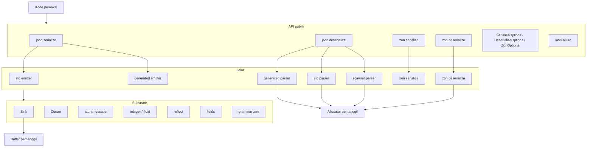
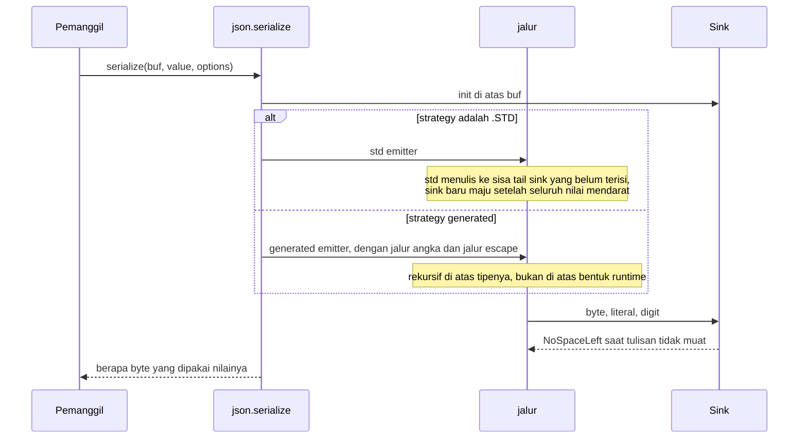
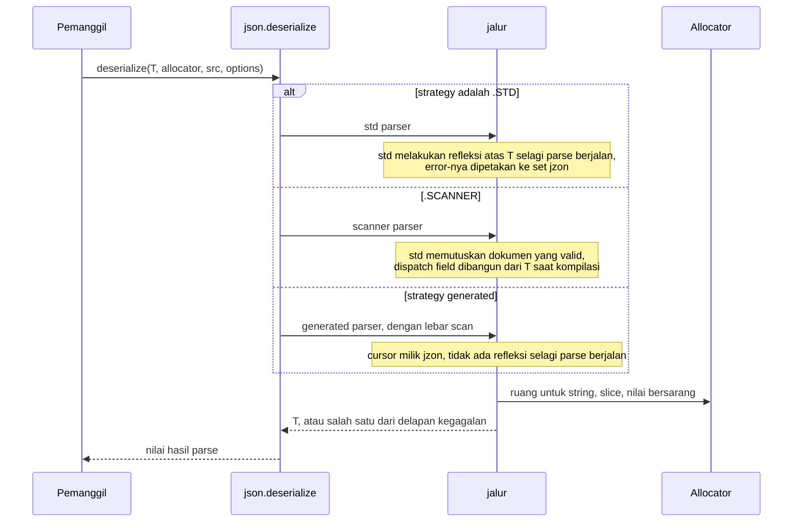
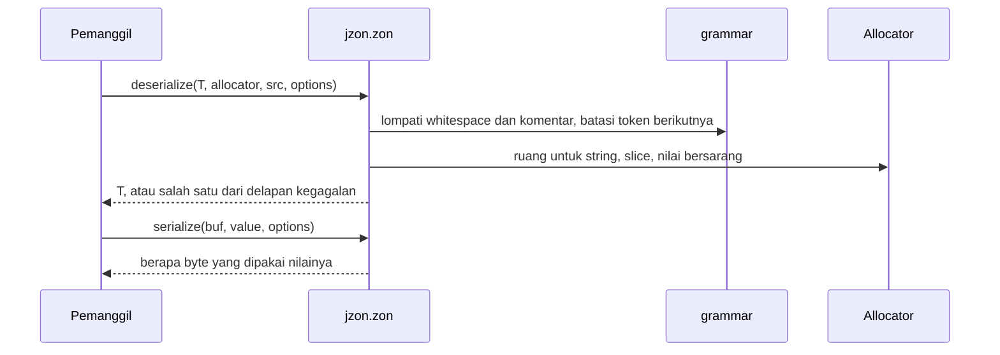

# Desain tingkat tinggi jzon

## Ruang lingkup

jzon adalah library JSON dan ZON murni Zig, hanya memakai standard library. Ia membaca dan menulis grammar JSON RFC 8259 dan bentuk ZON yang dipakai `build.zig.zon` secara langsung. Dokumen ini membahas bentuk library-nya: layer-nya, komponennya, alur-alurnya, dan bagaimana sebuah strategy memilih jalur. Detail tingkat byte ada di `lld-id.md`.

Desain JSON berpegang pada satu gagasan: setiap jalur menghasilkan byte yang sama dan membaca dokumen yang sama, jadi pemanggil yang menukar satu dengan yang lain mengubah biaya panggilannya dan tidak lebih. ZON punya satu jalur per arah, jadi tidak ada strategy yang perlu dipilih.

## Layer

- Layer API adalah dua namespace, `jzon.json` dan `jzon.zon`, masing-masing dengan satu `serialize` dan satu `deserialize`, ditambah options dan set error-nya. Untuk JSON ia memiliki satu keputusan: jalur mana yang berjalan.
- Sebuah jalur memiliki cara sebuah nilai dirender atau dibaca. Ia tidak pernah melihat strategy mana yang menyebutnya.
- Substrate memiliki mekanismenya: ke mana byte berikutnya pergi, di mana sebuah token berakhir, bagaimana sebuah byte di-escape, bagaimana sebuah angka dieja, field mana yang diisi dokumen, dan pertanyaan tipe yang ditanyakan saat kompilasi.
- Buffer dan allocator milik pemanggil. jzon tidak memegang keduanya, dan tidak pernah menyentuh file.

## Komponen

| Komponen | Tanggung jawab |
| :- | :- |
| `lib.zig` | permukaan publik: `json`, `zon`, `lastFailure`, versi |
| `Sink.zig` | cursor tulis: ke mana byte berikutnya pergi dan apakah masih ada ruang |
| `Cursor.zig` | cursor baca JSON: dari mana byte berikutnya datang dan di mana sebuah token berakhir |
| `StringSpan.zig` | token string yang sudah ditemukan: byte di antara kutip, dan apakah ada escape di dalamnya |
| `lane.zig` | lebar vector lane dan tes escape pada satu chunk |
| `cursor_vector.zig` | dua scan cursor yang sama, satu lane sekaligus: lompat whitespace, akhir string |
| `escape.zig` | aturan string RFC 8259 bagian 7, dua arah, satu pemilik |
| `escape_vector.zig` | encoding yang sama, dengan scan escape satu lane sekaligus |
| `integer.zig` | dua cara menulis integer, satu cara membacanya kembali dengan range dijaga |
| `float.zig` | bentuk angka JSON dari float, dua arah |
| `reflect.zig` | pertanyaan tipe yang ditanyakan saat kompilasi, di satu tempat |
| `serialize/SerializeOptions.zig` | apa yang diserahkan pemanggil ke render JSON |
| `serialize/EmitShape.zig` | jalur angka dan escape mana yang diambil render generated |
| `serialize/serialize.zig` | entry point tulis JSON: pilih jalur, jalankan, laporkan panjangnya |
| `serialize/std_emitter.zig` | render lewat `std.json.Stringify` ke buffer pemanggil |
| `serialize/generated_emitter.zig` | render lewat kode yang dibangun dari tipenya saat kompilasi |
| `deserialize/DeserializeOptions.zig` | apa yang diserahkan pemanggil ke parse JSON |
| `deserialize/deserialize.zig` | entry point baca JSON: pilih jalur dan jalankan |
| `deserialize/Failure.zig` | field dan byte mana tempat parse gagal terakhir di thread ini berhenti |
| `deserialize/std_parser.zig` | parse lewat reflection `std.json`, dengan error std dipetakan ke set jzon |
| `deserialize/scanner_parser.zig` | token dari `std.json.Scanner`, dispatch dibangun dari tipenya |
| `deserialize/generated_parser.zig` | parse langsung dari cursor jzon, dispatch dibangun dari tipenya |
| `deserialize/fields.zig` | field mana dari target yang diisi dokumen, dan apa yang terjadi pada sisanya |
| `deserialize/ScanShape.zig` | scan baca mana dari keduanya yang dijalankan parse |
| `deserialize/skip.zig` | melompati satu nilai JSON utuh tanpa membangun apa pun darinya |
| `deserialize/string_value.zig` | token string menjadi byte: slice dari dokumen, atau salinan |
| `zon/lib.zig` | namespace `jzon.zon` |
| `zon/ZonOptions.zig` | apa yang diserahkan pemanggil ke panggilan ZON, dua arah |
| `zon/grammar.zig` | kelas byte dan batas token ZON: whitespace, komentar, nama, angka, string |
| `zon/serialize.zig` | menulis nilai bertipe sebagai ZON, multiline atau compact |
| `zon/deserialize.zig` | membaca ZON ke nilai bertipe, di-generate dari tipenya |

## Alur tulis JSON

Tidak ada yang dialokasi. Nilai yang tidak muat melaporkan `Jzon_Serialize_NoSpaceLeft` tanpa panjang, jadi apa pun isi buffer sesudahnya bukan nilai yang ter-render.

## Alur baca JSON

Semua yang ditunjuk hasilnya berasal dari allocator pemanggil. Di bawah `strings = .BORROW` string tanpa escape menjadi slice dari dokumennya, jadi dokumen itu harus hidup lebih lama dari nilainya.

## Alur ZON

- Sisi baca menelusuri teks sekali, dengan dispatch dibangun dari `T` saat kompilasi. Tidak ada `std.zig.Ast` yang dibangun.
- Angka dicek dengan `std.zig.parseNumberLiteral` dan escape string didekode dengan `std.zig.string_literal`, jadi grammar Zig yang memutuskan angka atau escape yang valid.
- Sisi tulis menulis ke `Sink`, sama seperti JSON, dengan layout yang disebut `ZonOptions.layout`.
- Pencatatan field (hilang, ganda, default) memakai `fields.zig` yang sama dengan JSON, dan kegagalan dilaporkan lewat `lastFailure` yang sama.

## Ke mana sebuah strategy mendarat

Strategy JSON adalah nama untuk sebuah pasangan. Entry point menguraikannya dan jalur di bawahnya hanya diberi apa yang ia butuhkan.

Sisi tulis:

| Strategy | Jalur integer | Scan escape |
| :- | :- | :- |
| `.GENERATED_FMT` | `std.fmt` | satu byte sekali jalan |
| `.GENERATED` | digit langsung ke buffer | satu byte sekali jalan |
| `.GENERATED_VECTOR` | digit langsung ke buffer | satu vector lane sekaligus |

Sisi baca:

| Strategy | Lebar scan |
| :- | :- |
| `.GENERATED` | satu byte sekali jalan |
| `.GENERATED_VECTOR` | satu vector lane sekaligus |

Kedua sumbu di sisi tulis saling bebas, jadi setiap pasangan ada di emitter-nya. Empat strategy itu adalah pasangan yang layak dinamai, bukan satu-satunya yang bisa dijalankan emitter.

## Model alokasi

| Arah | Yang dialokasi | Pemiliknya |
| :- | :- | :- |
| serialize, JSON dan ZON | tidak ada | buffer pemanggil memuat seluruh hasilnya |
| deserialize, `strings = .COPY` | setiap string, slice, dan nilai bersarang | allocator pemanggil |
| deserialize, `strings = .BORROW` | slice, nilai bersarang, dan string mana pun yang membawa escape | allocator pemanggil, dengan string bersih menunjuk ke dalam dokumen |

String ber-escape didekode ke allocator mode mana pun yang diminta, karena byte hasil dekodenya tidak muncul di mana pun dalam dokumen untuk ditunjuk. String multiline ZON lebih dari satu baris digabung ke allocator dengan alasan yang sama.

## Model error

Satu set error per panggilan, dipakai bersama oleh setiap jalur di bawahnya:

| Panggilan | Set | Kegagalan |
| :- | :- | :- |
| `json.serialize` | `json.SerializeError` | `Jzon_Serialize_NoSpaceLeft` |
| `json.deserialize` | `json.DeserializeError` | delapan: `Jzon_Deserialize_UnknownField`, `MissingField`, `UnknownEnumValue`, `Truncated`, `Unexpected`, `BadNumber`, `BadEscape`, `OutOfMemory` |
| `zon.serialize` | `zon.SerializeError` | `Jzon_ZonSerialize_NoSpaceLeft` |
| `zon.deserialize` | `zon.DeserializeError` | delapan kondisi yang sama sebagai `Jzon_ZonDeserialize_*` |

Setiap modul memiliki set-nya sendiri dan menerjemahkan laporan dari fungsi-fungsi yang ia panggil sekali, di fungsi publiknya. Jalur JSON yang tidak bisa membedakan dua kegagalan tetap melapor lewat set yang sama: `.STD` melaporkan escape rusak sebagai syntax error alih-alih `BadEscape`, karena std tidak memisahkan keduanya. Pemanggil menulis satu `catch` dan tidak perlu menengoknya lagi setelah mengganti strategy.

Nilai error tidak membawa nama field atau offset, jadi `lastFailure()` adalah jalur sampingnya: per thread, diisi parse yang gagal, dibaca tepat setelahnya.

## Kenapa strategy-nya ada

Jalur JSON berbasis std adalah yang paling mampu. Keduanya menerima setiap bentuk yang diterima std, termasuk bentuk yang tidak punya padanan JSON di jalur generated, dan itulah kenapa keduanya jadi default.

Jalur generated menguraikan bentuk tipenya saat kompilasi. Di sisi tulis itu berarti setiap key object, kutipnya, titik duanya, dan koma sebelumnya runtuh jadi satu literal, sehingga sebuah field berbiaya satu salinan berukuran tetap ditambah nilainya. Di sisi baca itu berarti tidak ada refleksi selagi parse berjalan dan tidak ada token yang dibangun untuk field yang tidak dimiliki tipenya.

Pertukaran itulah keseluruhan desainnya: kemampuan sebagai default, dan jalur yang diuraikan saat kompilasi yang dipilih pemanggil per call-site begitu bentuknya diketahui berupa record biasa. `benchmark-id.md` memberi angka untuk nilai pertukaran itu pada satu record.
