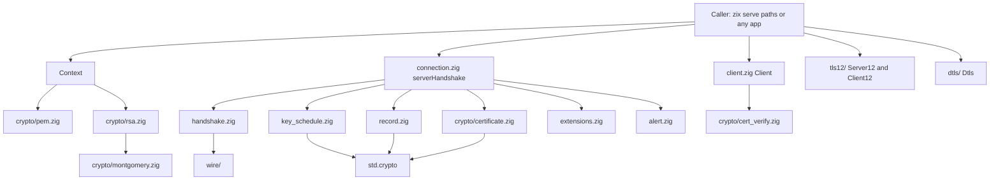
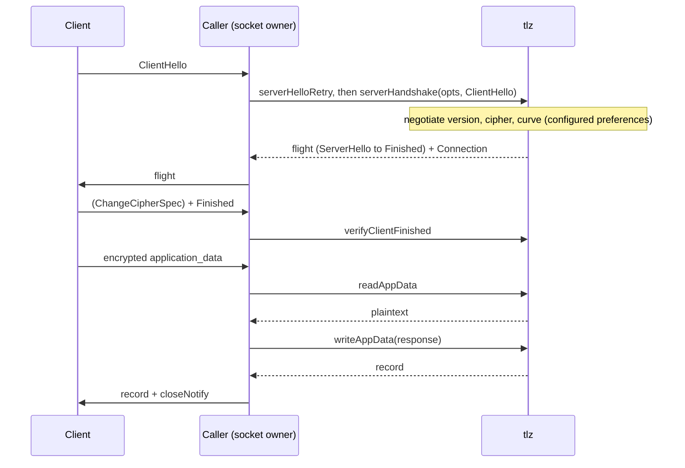
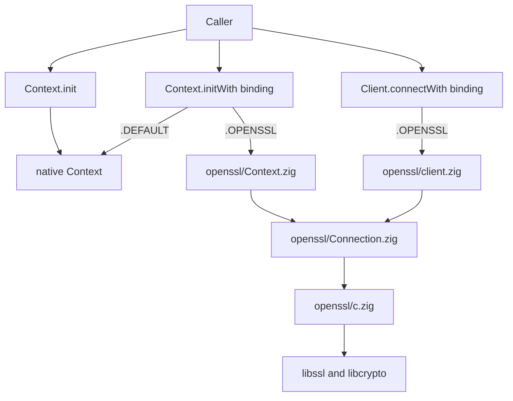

# tlz high-level design

tlz is TLS 1.3, TLS 1.2, and DTLS 1.2 written in pure Zig on `std.crypto`. It is a standalone package under `src/tlz`, and zix reaches it as `zix.tlz`. An optional OpenSSL backend can be chosen per context (see [Backend model](#backend-model)).

## Goals

- Pure Zig on `std.crypto` primitives by default. The default path has no OpenSSL, no BoringSSL, and no C FFI. The OpenSSL backend is opt-in per context.
- TLS 1.3 (RFC 8446) plus a TLS 1.2 floor (RFC 5246, RFC 5288). 1.3 is preferred, nothing below 1.2 is offered, and TLS 1.0, TLS 1.1, and SSL are never offered (RFC 8996).
- Sans-I/O: a handshake call takes the bytes received and returns the bytes to send. tlz owns no socket and no loop, so the same code serves a blocking task, an epoll worker, or an io_uring ring.
- Server configuration is one user-owned `tlz.Context` (the loaded cert and key plus the validated policy), built once and shared by pointer.
- Forward secrecy (ECDHE) and AEAD on both versions by construction.
- A verifying client: ALPN offer, X.509 chain (RFC 5280), and hostname or IP identity (RFC 6125).
- DTLS 1.2 (RFC 6347) for datagram transports, with the SRTP key export (RFC 5764).

## Architecture



The server handshake runs through `connection.zig`, which composes the wire, key schedule, record, certificate, extension, and alert layers. The TLS 1.2 track (`tls12/`) and the DTLS track (`dtls/`) reuse the leaf primitives (certificate, ECDSA signing, P-256 ECDHE) and add their own record layer and flights.

## Source layout

Every directory below holds the records (one PascalCase file each) of the functions file with the same name next to it. For example `connection/Connection.zig` is the record that `connection.zig` hands out.

| Path | Role |
| :- | :- |
| `lib.zig` | Public surface: version, server, client, context, verify, record helpers, `Dtls` |
| `context.zig`, `context/` | `Context` (loaded cert and key plus validated policy), `Config`, `Version` |
| `connection.zig`, `connection/` | Server handshake driver (`serverHandshake`, HelloRetryRequest) and the post-handshake `Connection` |
| `client.zig`, `client/` | TLS 1.3 client handshake (`start`, `finish`) and `ClientConnection` |
| `handshake.zig`, `handshake/` | ClientHello parse, version, cipher, and curve negotiation, ServerHello and HelloRetryRequest serialization |
| `key_schedule.zig`, `key_schedule/` | HKDF-SHA256 key schedule and the running transcript hash |
| `record.zig`, `record/` | TLS 1.3 AEAD record protect and deprotect, content type framing |
| `extensions.zig`, `extensions/` | ALPN negotiation, EncryptedExtensions |
| `alert.zig`, `alert/` | Alert codes, outbound alert records, inbound alert classification |
| `cipher_suite.zig`, `named_group.zig`, `signature_scheme.zig`, `extension_type.zig`, `alpn.zig` | Wire enums |
| `wire/` | `Reader` and `Writer`, big-endian, over a caller buffer |
| `binding.zig` | `Binding` enum (`DEFAULT`, `OPENSSL`), `isBuilt`, `requireBuilt` |
| `openssl/` | Optional OpenSSL backend: `Context` (SSL_CTX), `Connection` (SSL over a memory BIO pair), `client.zig`, the error queue reader, and `c.zig` (the only C importer) |
| `crypto/certificate.zig`, `crypto/certificate/` | Certificate, CertificateVerify, and Finished builders, the `SigningKey` |
| `crypto/cert_verify.zig`, `crypto/cert_verify/` | Peer chain (RFC 5280) and hostname or IP identity (RFC 6125) |
| `crypto/pem.zig` | PEM to DER, ECDSA SEC1 scalar and Ed25519 PKCS#8 seed extraction |
| `crypto/rsa.zig`, `crypto/rsa/` | RSA signing: key parse, PKCS#1 v1.5 and PSS, the CRT sign |
| `crypto/montgomery.zig`, `crypto/montgomery/` | Constant-time Montgomery arithmetic for the RSA CRT sign, with an ADX asm body on x86_64 |
| `crypto/DerReader.zig`, `crypto/der_guard.zig` | Bounded DER reading and a size guard in front of the std certificate parser |
| `crypto/std_rsa_verify.zig` | Thin wrapper over the std RSA verify, kept apart while the std signature changes between Zig versions |
| `tls12/` | TLS 1.2 track: PRF, record layer, version select, server handshake, client |
| `dtls/` | DTLS 1.2 track: record layer with anti-replay, handshake fragments, cookie, retransmit timer, key export, `use_srtp`, server, client |

The DTLS files live here and not in a transport tree because they share leaf primitives with the 1.2 track and because DTLS is a TLS profile. They are public under `tlz.Dtls`. `dtls/connection.zig` builds its own flights instead of reusing `tls12/connection.zig`: the DTLS transcript is taken over 12 byte DTLS headers as if unfragmented (RFC 6347 section 4.2.6), which the TLS framed hashing cannot produce.

## Version policy

| Version | Policy | Status |
| :- | :- | :- |
| TLS 1.3 | preferred, default | implemented (RFC 8446) |
| TLS 1.2 | floor, required | implemented (RFC 5246, RFC 5288) |
| TLS 1.1, 1.0, SSL | never offered | deprecated or prohibited (RFC 8996, 7568, 6176) |
| DTLS 1.2 | separate track | implemented (RFC 6347) |

TLS 1.2 is the floor because RFC 5246 is not deprecated and is still widely deployed. The 1.2 suites are restricted to ECDHE with AEAD, so forward secrecy and authenticated encryption hold on both versions. A `Context` narrows the range with `min_version` and `max_version`. `allowsTls13` and `allowsTls12` tell the caller which tracks it may run.

## Implemented crypto

| Axis | TLS 1.3 | TLS 1.2 |
| :- | :- | :- |
| Cipher | `TLS_AES_128_GCM_SHA256` | `ECDHE_ECDSA_AES128_GCM_SHA256` (0xC02B) |
| Key exchange | X25519, secp256r1 ECDHE | secp256r1 ECDHE |
| Signature | ECDSA P-256, Ed25519, or RSA (`rsa_pss_rsae_sha256`) | ECDSA P-256 |

There is no finite-field DHE and no RSA key exchange, so key exchange strength is set by the ECDHE curve alone, not by a dhparam file. An RSA certificate signs the TLS 1.3 CertificateVerify with `rsa_pss_rsae_sha256`, so it needs TLS 1.3 (the 1.2 track is ECDSA only). RSA-2048 is the smallest key `Context` accepts.

Build note (record throughput): AES-GCM runs on `std.crypto`, which picks the hardware or software backend at comptime from the build CPU target. The hardware path needs both `aes` and `pclmul`. A target without them compiles the software fallback, which is much slower. `x86_64_v3` does not include them, they are separate features. Build with `-Dcpu=native`, or a target such as `-Dcpu=x86_64_v3+aes+pclmul` (on aarch64, `+aes`). Measured numbers are in [`bench-en.md`](bench-en.md).

## Server configuration: Context

```zig
var tls = try tlz.Context.init(allocator, io, .{
    .cert_path = "certs/ecdsa_p256_cert.pem",
    .key_path = "certs/ecdsa_p256_key.pem",
    .alpn = &.{.HTTP_1_1},
});
defer tls.deinit();

const opts = tls.handshakeOptions(ephemeral_secret, server_random, pss_salt);
var result = try tlz.serverHandshake(opts, client_hello, &out);
```

- `Context.Config` is the plain settings struct: `cert_path`, `key_path`, `alpn`, `min_version`, `max_version`, `curves`, `ciphers`, `prefer_server_ciphers`, `hsts_max_age_s`.
- `Context.init` validates the policy, loads both PEM files, detects the key type from the certificate (ECDSA, Ed25519, or RSA), and parses the key once, on the cold path. A handshake then reads a ready context with no PEM work.
- `handshakeOptions` fills the per-connection handshake input from the context plus the fresh randoms the caller supplies.
- Curves and ciphers are typed enum slices, validated against the implemented set. An unsupported value (P-384, ML-KEM, AES-256, ChaCha20, any RSA key exchange suite) is a startup error, never a silent no-op. The set widens with no API change as crypto lands.

## Handshake flow (server, TLS 1.3)



`serverHandshake` returns the bytes to send plus a `Connection`. When the client's chosen curve has no key_share, the handshake takes two rounds: `serverHelloRetry` builds the HelloRetryRequest, then `serverHandshakeAfterRetry` finishes on the second ClientHello. A 1.2-only client surfaces as `Tlz_Connection_UnsupportedTlsVersion`, which the caller routes to the 1.2 track (`Server12`), subject to the version policy. `alertForError` and `alertRecordForError` turn a handshake error into the alert to send.

## Client

`tlz.Client` (1.3) and `tlz.Client12` (1.2) mirror the server. `start` builds the ClientHello (ALPN plus a signature_algorithms list of ecdsa_secp256r1_sha256 and ed25519). `finish` takes the server flight, verifies the server signature (CertificateVerify for 1.3, ServerKeyExchange for 1.2) through `std.crypto.Certificate`, and returns a `ClientConnection`. Chain and identity checks are `verifyChain`, `verifyCertChain`, `verifyCertHostname`, and `verifyCertIdentity` (RFC 5280, RFC 6125). The IP SAN check is done by hand, since std is DNS only.

## Backend model

Two backends share one public surface. Native is the default and needs nothing outside the Zig standard library.

| Backend | I/O model | Selected by |
| :- | :- | :- |
| native | sans-I/O, caller owns the socket | `Context.init`, or `Context.initWith(..., .DEFAULT)` |
| openssl | sans-I/O over a memory BIO pair, caller owns the socket | `Context.initWith(..., .OPENSSL)`, `Client.connectWith(..., .OPENSSL)` |



- Detection: `build.zig` looks for OpenSSL on the build host, first with `pkg-config openssl`, then in the standard header paths. There is no build flag. When found, the package links libssl, libcrypto, and libc, and the binding is compiled in. When not found, nothing from OpenSSL is linked or included. A cross target is never detected.
- Selection: the binding is a `comptime` parameter, placed last. The return type follows the binding, so there is no runtime switch. `Context.ContextFor(binding)` and `Client.ConnectionFor(binding)` name that type, for a struct field.
- `Context.init` and `Context.initWith(..., .DEFAULT)` build the same native context, even when OpenSSL is compiled in.
- Choosing `.OPENSSL` on a build without OpenSSL is a build error with a clear message, never a runtime error. A build that never chooses `.OPENSSL` always compiles.
- `Client.connectWith(..., .DEFAULT)` is a build error: the native client is `Client.start` plus `Client.finish`.
- Version floor: OpenSSL 3.0. An older OpenSSL is a build error.
- The OpenSSL context reads only `cert_path`, `key_path`, `alpn`, `min_version`, and `max_version` from `Config`. Curves and ciphers keep the OpenSSL defaults.
- No silent fallback: a failed OpenSSL handshake returns an error, it never switches to native.

```zig
var ssl_ctx = try tlz.Context.initWith(allocator, io, .{
    .cert_path = "certs/ecdsa_p256_cert.pem",
    .key_path = "certs/ecdsa_p256_key.pem",
    .alpn = &.{.H2},
}, .OPENSSL);
defer ssl_ctx.deinit();

var conn = try ssl_ctx.newConnection();
defer conn.deinit();

// One step per read: feed the peer bytes, send what comes back.
const to_send = try conn.handshake(peer_bytes, &out);
```

After the handshake the names match native: `readAppData`, `writeAppData`, `closeNotify`, `selectedAlpn`, `deinit`. The handshake differs: native is one `serverHandshake` call, openssl is a `handshake(incoming, out)` loop until `handshakeDone()`. OpenSSL can queue more output than `out` holds, so the caller checks `pendingLen` and calls `drain` until it is 0 before waiting on the peer.

Errors: `initWith` reports `Tlz_Context_*` and `connectWith` reports `Tlz_Client_*`, with the same condition name the OpenSSL module failed on (for example `Tlz_Context_KeyMismatch`, `Tlz_Client_PeerVerifyFailed`). Calls on the returned OpenSSL values report their own sets: `Tlz_OpensslContext_*` and `Tlz_OpensslConnection_*`. The OpenSSL error text is kept for the log line, control flow uses the codes.

## Inbound alerts (RFC 8446 6)

`parseInboundAlert` classifies a received alert: `close_notify` (description 0) is a clean close, any other is fatal. `Connection.readAppData` reports an alert record as `PeerClosed`, so a caller never reads an alert as data.

## Memory model

- No allocator in the handshake or record path. Both work in caller-provided fixed buffers.
- `Context` owns one heap allocation: the duplicated certificate DER, freed by `deinit`. The signing key and the policy slices are values or borrowed slices.
- The transcript and key schedule are fixed size (`Secret = [32]u8`, SHA-256 throughout).
- The rules above are for the native backend. The OpenSSL backend allocates inside OpenSSL (the `SSL_CTX`, each `SSL`, and its two memory BIOs), all freed by `deinit`.

## Use in zix

zix imports tlz and owns every socket. The serve paths live in zix, not in tlz:

| zix path | What it does with tlz |
| :- | :- |
| `src/zix/tls/tls_session.zig` | Resumable TLS 1.3 server session over `serverHandshake` and `Connection`, fed ciphertext as it arrives (multiplexed loops) |
| `src/zix/multiplexers/tls_conn.zig` | Shared transport of one multiplexed TLS connection: the session plus outbound ciphertext staged on EAGAIN |
| `src/zix/tcp/http1/tls_mux.zig` | https/1.1 for `.EPOLL` and `.URING`, TLS 1.3 only |
| `src/zix/tcp/http1/tls_serve.zig` | https/1.1 for `.ASYNC`, one task per connection, TLS 1.3 and the 1.2 track |
| `src/zix/tls/h2_terminator.zig` | h2 over TLS terminator for `.ASYNC` (TLS 1.3 and 1.2), requires ALPN h2 |
| `src/zix/tcp/http2/tls_mux.zig`, `tls_serve.zig` | h2 over TLS for `.EPOLL` / `.URING` and for `.ASYNC` |
| `src/zix/tcp/http2/grpc/tls_mux.zig`, `tls_serve.zig` | gRPC over TLS for `.EPOLL` / `.URING` and for `.ASYNC` |

A server opts in with `tls: ?*zix.tlz.Context` on `Http1`, `Http2`, or `Grpc` config. With `tls_port` set as well, one server serves cleartext on `port` and TLS on `tls_port` from the same workers. The cleartext hot path is unchanged by any of this. Details are in [`lld-en.md`](lld-en.md).

zix servers take the native `*zix.tlz.Context`, so the OpenSSL backend is not attached to `Http1`, `Http2`, or `Grpc`. It is a tlz opt-in. When the build host has OpenSSL, the zix build links libssl, libcrypto, and libc as well.

## References

- LLD: [`lld-en.md`](lld-en.md).
- Bench: [`bench-en.md`](bench-en.md).
