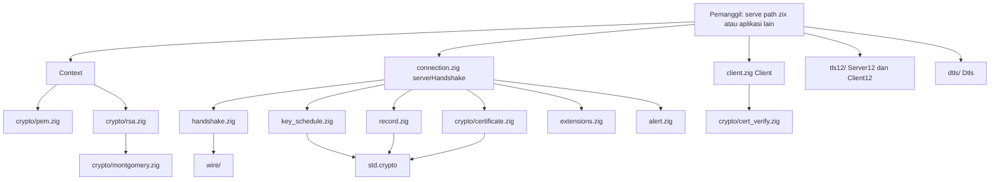
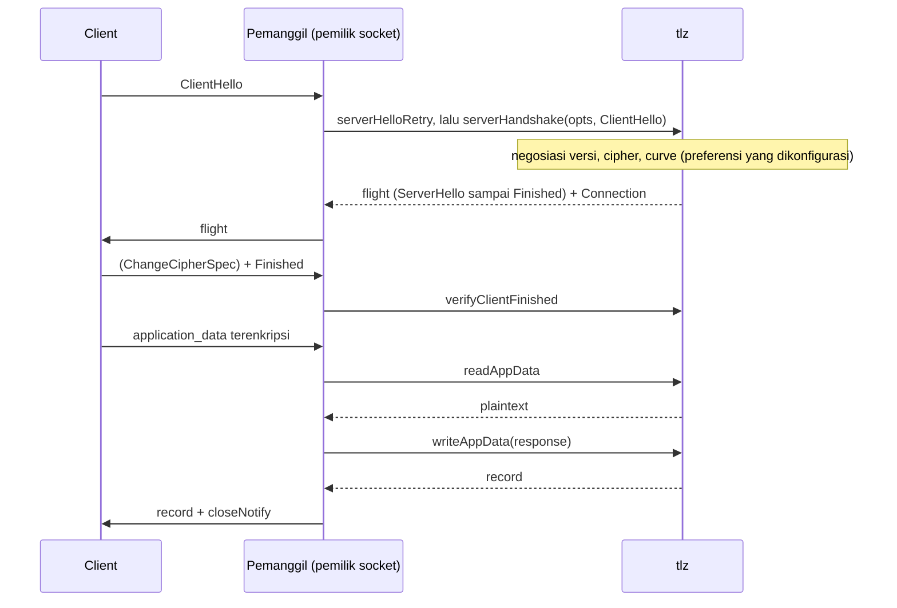
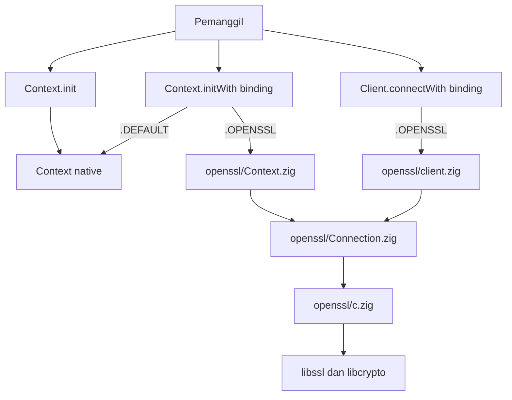

# tlz high-level design

tlz adalah TLS 1.3, TLS 1.2, dan DTLS 1.2 yang ditulis dalam Zig murni di atas `std.crypto`. tlz adalah package mandiri di `src/tlz`, dan zix menjangkaunya sebagai `zix.tlz`. Backend OpenSSL opsional bisa dipilih per context (lihat [Model backend](#model-backend)).

## Tujuan

- Zig murni di atas primitive `std.crypto` secara default. Jalur default tanpa OpenSSL, tanpa BoringSSL, dan tanpa C FFI. Backend OpenSSL bersifat opt-in per context.
- TLS 1.3 (RFC 8446) ditambah TLS 1.2 sebagai batas bawah (RFC 5246, RFC 5288). 1.3 diutamakan, tidak ada yang di bawah 1.2, dan TLS 1.0, TLS 1.1, serta SSL tidak pernah ditawarkan (RFC 8996).
- Sans-I/O: pemanggilan handshake menerima byte yang diterima dan mengembalikan byte yang harus dikirim. tlz tidak memiliki socket maupun loop, jadi kode yang sama melayani blocking task, epoll worker, atau io_uring ring.
- Konfigurasi server adalah satu `tlz.Context` milik pengguna (cert dan key yang sudah dimuat ditambah policy yang sudah divalidasi), dibuat sekali dan dibagikan lewat pointer.
- Forward secrecy (ECDHE) dan AEAD di kedua versi, sejak dari rancangannya.
- Client yang memverifikasi: penawaran ALPN, rantai X.509 (RFC 5280), dan identitas hostname atau IP (RFC 6125).
- DTLS 1.2 (RFC 6347) untuk transport datagram, dengan ekspor kunci SRTP (RFC 5764).

## Arsitektur



Handshake server berjalan lewat `connection.zig`, yang menyusun layer wire, key schedule, record, certificate, extension, dan alert. Jalur TLS 1.2 (`tls12/`) dan jalur DTLS (`dtls/`) memakai ulang primitive dasar (certificate, signing ECDSA, ECDHE P-256) dan menambahkan record layer serta flight mereka sendiri.

## Susunan source

Setiap direktori di bawah berisi record (satu file PascalCase per record) dari file fungsi bernama sama di sebelahnya. Contohnya `connection/Connection.zig` adalah record yang diberikan oleh `connection.zig`.

| Path | Peran |
| :- | :- |
| `lib.zig` | Permukaan publik: versi, server, client, context, verify, helper record, `Dtls` |
| `context.zig`, `context/` | `Context` (cert dan key yang dimuat ditambah policy yang divalidasi), `Config`, `Version` |
| `connection.zig`, `connection/` | Penggerak handshake server (`serverHandshake`, HelloRetryRequest) dan `Connection` setelah handshake |
| `client.zig`, `client/` | Handshake client TLS 1.3 (`start`, `finish`) dan `ClientConnection` |
| `handshake.zig`, `handshake/` | Parse ClientHello, negosiasi versi, cipher, dan curve, serialisasi ServerHello dan HelloRetryRequest |
| `key_schedule.zig`, `key_schedule/` | Key schedule HKDF-SHA256 dan transcript hash yang berjalan |
| `record.zig`, `record/` | Protect dan deprotect record AEAD TLS 1.3, framing content type |
| `extensions.zig`, `extensions/` | Negosiasi ALPN, EncryptedExtensions |
| `alert.zig`, `alert/` | Kode alert, record alert keluar, klasifikasi alert masuk |
| `cipher_suite.zig`, `named_group.zig`, `signature_scheme.zig`, `extension_type.zig`, `alpn.zig` | Enum wire |
| `wire/` | `Reader` dan `Writer`, big-endian, di atas buffer milik pemanggil |
| `binding.zig` | Enum `Binding` (`DEFAULT`, `OPENSSL`), `isBuilt`, `requireBuilt` |
| `openssl/` | Backend OpenSSL opsional: `Context` (SSL_CTX), `Connection` (SSL di atas sepasang memory BIO), `client.zig`, pembaca error queue, dan `c.zig` (satu-satunya yang meng-import C) |
| `crypto/certificate.zig`, `crypto/certificate/` | Builder Certificate, CertificateVerify, dan Finished, serta `SigningKey` |
| `crypto/cert_verify.zig`, `crypto/cert_verify/` | Rantai peer (RFC 5280) dan identitas hostname atau IP (RFC 6125) |
| `crypto/pem.zig` | PEM ke DER, ekstraksi scalar ECDSA SEC1 dan seed Ed25519 PKCS#8 |
| `crypto/rsa.zig`, `crypto/rsa/` | Signing RSA: parse key, PKCS#1 v1.5 dan PSS, sign CRT |
| `crypto/montgomery.zig`, `crypto/montgomery/` | Aritmetika Montgomery constant-time untuk sign CRT RSA, dengan body asm ADX di x86_64 |
| `crypto/DerReader.zig`, `crypto/der_guard.zig` | Pembacaan DER yang dibatasi dan penjaga ukuran di depan parser certificate std |
| `crypto/std_rsa_verify.zig` | Pembungkus tipis untuk verify RSA std, dipisah selama signature std berubah antar versi Zig |
| `tls12/` | Jalur TLS 1.2: PRF, record layer, pemilihan versi, handshake server, client |
| `dtls/` | Jalur DTLS 1.2: record layer dengan anti-replay, fragmen handshake, cookie, timer retransmit, ekspor kunci, `use_srtp`, server, client |

File DTLS ada di sini dan bukan di tree transport karena memakai primitive dasar yang sama dengan jalur 1.2 dan karena DTLS adalah profil TLS. File-file ini publik di bawah `tlz.Dtls`. `dtls/connection.zig` membangun flight-nya sendiri, bukan memakai ulang `tls12/connection.zig`: transcript DTLS diambil atas header DTLS 12 byte seolah tidak terfragmentasi (RFC 6347 bagian 4.2.6), yang tidak bisa dihasilkan oleh hashing berbingkai TLS.

## Kebijakan versi

| Versi | Kebijakan | Status |
| :- | :- | :- |
| TLS 1.3 | diutamakan, default | diimplementasikan (RFC 8446) |
| TLS 1.2 | batas bawah, wajib | diimplementasikan (RFC 5246, RFC 5288) |
| TLS 1.1, 1.0, SSL | tidak pernah ditawarkan | deprecated atau dilarang (RFC 8996, 7568, 6176) |
| DTLS 1.2 | jalur terpisah | diimplementasikan (RFC 6347) |

TLS 1.2 menjadi batas bawah karena RFC 5246 belum deprecated dan masih banyak dipakai. Suite 1.2 dibatasi ke ECDHE dengan AEAD, jadi forward secrecy dan authenticated encryption berlaku di kedua versi. `Context` mempersempit rentang dengan `min_version` dan `max_version`. `allowsTls13` dan `allowsTls12` memberi tahu pemanggil jalur mana yang boleh dijalankan.

## Crypto yang diimplementasikan

| Sumbu | TLS 1.3 | TLS 1.2 |
| :- | :- | :- |
| Cipher | `TLS_AES_128_GCM_SHA256` | `ECDHE_ECDSA_AES128_GCM_SHA256` (0xC02B) |
| Key exchange | X25519, ECDHE secp256r1 | ECDHE secp256r1 |
| Signature | ECDSA P-256, Ed25519, atau RSA (`rsa_pss_rsae_sha256`) | ECDSA P-256 |

Tidak ada DHE finite-field dan tidak ada key exchange RSA, jadi kekuatan key exchange hanya ditentukan oleh curve ECDHE, bukan oleh file dhparam. Sertifikat RSA menandatangani CertificateVerify TLS 1.3 dengan `rsa_pss_rsae_sha256`, jadi butuh TLS 1.3 (jalur 1.2 hanya ECDSA). RSA-2048 adalah kunci terkecil yang diterima `Context`.

Catatan build (throughput record): AES-GCM berjalan di `std.crypto`, yang memilih backend hardware atau software saat comptime dari CPU target build. Jalur hardware butuh `aes` dan `pclmul` sekaligus. Target tanpa keduanya meng-compile fallback software, yang jauh lebih lambat. `x86_64_v3` tidak menyertakan keduanya, itu fitur terpisah. Build dengan `-Dcpu=native`, atau target seperti `-Dcpu=x86_64_v3+aes+pclmul` (di aarch64, `+aes`). Angka hasil pengukuran ada di [`bench-id.md`](bench-id.md).

## Konfigurasi server: Context

```zig
var tls = try tlz.Context.init(allocator, io, .{
    .cert_path = "certs/ecdsa_p256_cert.pem",
    .key_path = "certs/ecdsa_p256_key.pem",
    .alpn = &.{.HTTP_1_1},
});
defer tls.deinit();

const opts = tls.handshakeOptions(ephemeral_secret, server_random, pss_salt);
var result = try tlz.serverHandshake(opts, client_hello, &out);
```

- `Context.Config` adalah struct pengaturan biasa: `cert_path`, `key_path`, `alpn`, `min_version`, `max_version`, `curves`, `ciphers`, `prefer_server_ciphers`, `hsts_max_age_s`.
- `Context.init` memvalidasi policy, memuat kedua file PEM, mendeteksi jenis kunci dari sertifikat (ECDSA, Ed25519, atau RSA), dan mem-parse kunci sekali, di cold path. Handshake lalu membaca context yang sudah siap tanpa kerja PEM.
- `handshakeOptions` mengisi input handshake per koneksi dari context ditambah random segar yang diberikan pemanggil.
- Curve dan cipher adalah slice enum bertipe, divalidasi terhadap set yang diimplementasikan. Nilai yang tidak didukung (P-384, ML-KEM, AES-256, ChaCha20, suite key exchange RSA apa pun) menjadi error saat startup, tidak pernah diam-diam diabaikan. Set ini melebar tanpa perubahan API seiring crypto bertambah.

## Alur handshake (server, TLS 1.3)



`serverHandshake` mengembalikan byte yang harus dikirim ditambah sebuah `Connection`. Ketika curve pilihan client tidak punya key_share, handshake butuh dua putaran: `serverHelloRetry` membangun HelloRetryRequest, lalu `serverHandshakeAfterRetry` menyelesaikannya pada ClientHello kedua. Client yang hanya 1.2 muncul sebagai `Tlz_Connection_UnsupportedTlsVersion`, yang diarahkan pemanggil ke jalur 1.2 (`Server12`), sesuai kebijakan versi. `alertForError` dan `alertRecordForError` mengubah error handshake menjadi alert yang harus dikirim.

## Client

`tlz.Client` (1.3) dan `tlz.Client12` (1.2) adalah cermin dari server. `start` membangun ClientHello (ALPN ditambah daftar signature_algorithms berisi ecdsa_secp256r1_sha256 dan ed25519). `finish` menerima flight server, memverifikasi signature server (CertificateVerify untuk 1.3, ServerKeyExchange untuk 1.2) lewat `std.crypto.Certificate`, dan mengembalikan `ClientConnection`. Cek rantai dan identitas adalah `verifyChain`, `verifyCertChain`, `verifyCertHostname`, dan `verifyCertIdentity` (RFC 5280, RFC 6125). Cek SAN IP dikerjakan manual, karena std hanya mendukung DNS.

## Model backend

Dua backend berbagi satu permukaan publik. Native adalah default dan tidak butuh apa pun di luar standard library Zig.

| Backend | Model I/O | Dipilih oleh |
| :- | :- | :- |
| native | sans-I/O, pemanggil memiliki socket | `Context.init`, atau `Context.initWith(..., .DEFAULT)` |
| openssl | sans-I/O di atas sepasang memory BIO, pemanggil memiliki socket | `Context.initWith(..., .OPENSSL)`, `Client.connectWith(..., .OPENSSL)` |



- Deteksi: `build.zig` mencari OpenSSL di host build, pertama dengan `pkg-config openssl`, lalu di path header standar. Tidak ada build flag. Jika ditemukan, package me-link libssl, libcrypto, dan libc, dan binding ikut dikompilasi. Jika tidak ditemukan, tidak ada apa pun dari OpenSSL yang di-link atau di-include. Target cross tidak pernah terdeteksi.
- Pemilihan: binding adalah parameter `comptime`, diletakkan paling akhir. Tipe kembalian mengikuti binding, jadi tidak ada switch saat runtime. `Context.ContextFor(binding)` dan `Client.ConnectionFor(binding)` menamai tipe itu, untuk field struct.
- `Context.init` dan `Context.initWith(..., .DEFAULT)` membangun context native yang sama, bahkan ketika OpenSSL ikut dikompilasi.
- Memilih `.OPENSSL` di build tanpa OpenSSL adalah build error dengan pesan yang jelas, tidak pernah error saat runtime. Build yang tidak pernah memilih `.OPENSSL` selalu bisa dikompilasi.
- `Client.connectWith(..., .DEFAULT)` adalah build error: client native adalah `Client.start` ditambah `Client.finish`.
- Batas versi: OpenSSL 3.0. OpenSSL yang lebih lama adalah build error.
- Context OpenSSL hanya membaca `cert_path`, `key_path`, `alpn`, `min_version`, dan `max_version` dari `Config`. Curve dan cipher memakai default OpenSSL.
- Tanpa fallback diam-diam: handshake OpenSSL yang gagal mengembalikan error, tidak pernah berpindah ke native.

```zig
var ssl_ctx = try tlz.Context.initWith(allocator, io, .{
    .cert_path = "certs/ecdsa_p256_cert.pem",
    .key_path = "certs/ecdsa_p256_key.pem",
    .alpn = &.{.H2},
}, .OPENSSL);
defer ssl_ctx.deinit();

var conn = try ssl_ctx.newConnection();
defer conn.deinit();

// Satu langkah per read: berikan byte dari peer, kirim yang dikembalikan.
const to_send = try conn.handshake(peer_bytes, &out);
```

Setelah handshake, nama-namanya sama dengan native: `readAppData`, `writeAppData`, `closeNotify`, `selectedAlpn`, `deinit`. Handshake-nya berbeda: native adalah satu pemanggilan `serverHandshake`, openssl adalah loop `handshake(incoming, out)` sampai `handshakeDone()`. OpenSSL bisa mengantrekan output lebih banyak dari kapasitas `out`, jadi pemanggil memeriksa `pendingLen` dan memanggil `drain` sampai 0 sebelum menunggu peer.

Error: `initWith` melaporkan `Tlz_Context_*` dan `connectWith` melaporkan `Tlz_Client_*`, dengan nama kondisi yang sama dengan kegagalan di modul OpenSSL (contohnya `Tlz_Context_KeyMismatch`, `Tlz_Client_PeerVerifyFailed`). Pemanggilan pada nilai OpenSSL yang dikembalikan melaporkan set-nya sendiri: `Tlz_OpensslContext_*` dan `Tlz_OpensslConnection_*`. Teks error OpenSSL disimpan untuk baris log, alur kontrol memakai kodenya.

## Alert masuk (RFC 8446 6)

`parseInboundAlert` mengklasifikasikan alert yang diterima: `close_notify` (description 0) adalah penutupan bersih, selain itu fatal. `Connection.readAppData` melaporkan record alert sebagai `PeerClosed`, jadi pemanggil tidak pernah membaca alert sebagai data.

## Model memori

- Tidak ada allocator di jalur handshake maupun record. Keduanya bekerja di buffer tetap milik pemanggil.
- `Context` memiliki satu alokasi heap: salinan DER sertifikat, dibebaskan oleh `deinit`. Signing key dan slice policy adalah nilai atau slice pinjaman.
- Transcript dan key schedule berukuran tetap (`Secret = [32]u8`, SHA-256 di semua tempat).
- Aturan di atas berlaku untuk backend native. Backend OpenSSL mengalokasi di dalam OpenSSL (`SSL_CTX`, setiap `SSL`, dan dua memory BIO-nya), semuanya dibebaskan oleh `deinit`.

## Pemakaian di zix

zix meng-import tlz dan memiliki semua socket. Serve path ada di zix, bukan di tlz:

| Path zix | Yang dilakukan dengan tlz |
| :- | :- |
| `src/zix/tls/tls_session.zig` | Session server TLS 1.3 yang bisa dilanjutkan di atas `serverHandshake` dan `Connection`, diberi ciphertext saat tiba (loop multiplexed) |
| `src/zix/multiplexers/tls_conn.zig` | Transport bersama satu koneksi TLS multiplexed: session ditambah ciphertext keluar yang ditahan saat EAGAIN |
| `src/zix/tcp/http1/tls_mux.zig` | https/1.1 untuk `.EPOLL` dan `.URING`, hanya TLS 1.3 |
| `src/zix/tcp/http1/tls_serve.zig` | https/1.1 untuk `.ASYNC`, satu task per koneksi, TLS 1.3 dan jalur 1.2 |
| `src/zix/tls/h2_terminator.zig` | Terminator h2 lewat TLS untuk `.ASYNC` (TLS 1.3 dan 1.2), wajib ALPN h2 |
| `src/zix/tcp/http2/tls_mux.zig`, `tls_serve.zig` | h2 lewat TLS untuk `.EPOLL` / `.URING` dan untuk `.ASYNC` |
| `src/zix/tcp/http2/grpc/tls_mux.zig`, `tls_serve.zig` | gRPC lewat TLS untuk `.EPOLL` / `.URING` dan untuk `.ASYNC` |

Server mengaktifkannya dengan `tls: ?*zix.tlz.Context` di config `Http1`, `Http2`, atau `Grpc`. Jika `tls_port` juga diisi, satu server melayani cleartext di `port` dan TLS di `tls_port` dari worker yang sama. Hot path cleartext tidak berubah oleh semua ini. Detailnya ada di [`lld-id.md`](lld-id.md).

Server zix menerima `*zix.tlz.Context` native, jadi backend OpenSSL tidak dipasang ke `Http1`, `Http2`, atau `Grpc`. Backend ini adalah opt-in di tlz. Jika host build memiliki OpenSSL, build zix juga me-link libssl, libcrypto, dan libc.

## Referensi

- LLD: [`lld-id.md`](lld-id.md).
- Bench: [`bench-id.md`](bench-id.md).
